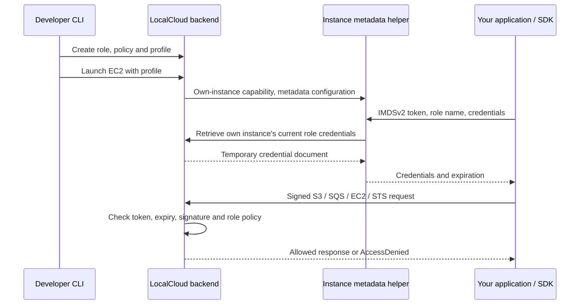

# EC2 instance roles and temporary credentials

LocalCloud now supports a bounded IAM → instance profile → EC2 → metadata → AWS SDK workflow. Your application can discover temporary role credentials automatically and use them against LocalCloud. It does not need LocalCloud's management token inside the guest.

For example, a worker can read an S3 object while its role denies writes. With `--iam enforce`, LocalCloud verifies the temporary credential signature and evaluates the role's current inline policies for each supported service request.

## What each piece does

- **IAM role:** a name, trust policy describing who may assume it, and inline permission policies.
- **Instance profile:** a named container holding one role. EC2 attaches the profile, rather than attaching the role directly.
- **STS:** creates temporary access keys, secret keys, session tokens and expiry times. `GetCallerIdentity` returns the assumed-role identity.
- **IMDS:** the metadata endpoint inside the guest. The AWS SDK obtains the attached role name and then its temporary credentials here.
- **Credential broker:** LocalCloud's internal delivery mechanism. Each metadata helper has a capability that only retrieves credentials for its own instance. It cannot use that capability for management APIs or another instance.



## Supported operations

| Service | Implemented subset |
| --- | --- |
| IAM roles | CreateRole, GetRole, ListRoles, DeleteRole, UpdateAssumeRolePolicy |
| IAM inline policies | PutRolePolicy, GetRolePolicy, ListRolePolicies, DeleteRolePolicy |
| IAM instance profiles | CreateInstanceProfile, GetInstanceProfile, ListInstanceProfiles, DeleteInstanceProfile, AddRoleToInstanceProfile, RemoveRoleFromInstanceProfile, ListInstanceProfilesForRole |
| STS | AssumeRole, GetCallerIdentity |
| EC2 profiles | RunInstances with IamInstanceProfile; AssociateIamInstanceProfile, ReplaceIamInstanceProfileAssociation, DisassociateIamInstanceProfile, DescribeIamInstanceProfileAssociations |
| Metadata | `/latest/meta-data/iam/`, `iam/info`, `iam/security-credentials/`, `iam/security-credentials/ROLE_NAME` |

The CLI supports these operation families with AWS-style names, such as `localcloud iam create-role`, `localcloud sts assume-role`, and `localcloud ec2 associate-iam-instance-profile`. IAM/STS also accept AWS Query protocol requests from the AWS SDK/CLI. Use normal LocalCloud management authentication to create resources; locally issued role sessions can call supported AWS endpoints with their own SigV4 signatures.

## Start-to-finish Docker example

This example uses Linux Docker networking. Use a backend address the guest can reach. A loopback URL such as `127.0.0.1` points back into the guest and is rejected for a runtime profile configuration. The address below is the host gateway of Docker's default bridge; replace it if your Docker networking differs.

First build a small SDK-enabled guest image in a separate example directory:

```dockerfile
FROM python:3.12-slim
RUN pip install --no-cache-dir boto3
CMD ["python3", "-m", "http.server", "8080"]
```

```bash
docker build -t my-role-app:dev .
```

Build the metadata helper from the LocalCloud project directory:

```bash
docker build -t localcloud:ec2-runtime .
```

Start the backend in its own terminal, using your existing server token:

```bash
export LOCALCLOUD_MANAGEMENT_TOKEN="$(cat ~/.config/localcloud/server-token)"
LOCALCLOUD_BRIDGE_GATEWAY="$(docker network inspect bridge --format '{{(index .IPAM.Config 0).Gateway}}')"
localcloud start --host 0.0.0.0 --port 4567 \
  --public-endpoint "http://${LOCALCLOUD_BRIDGE_GATEWAY}:4567" \
  --data .localcloud/ec2-roles.sqlite3 --iam enforce \
  --ec2-image ami-role-app=my-role-app:dev \
  --ec2-imds --ec2-helper-image localcloud:ec2-runtime
```

The host's firewall must allow guests to reach this backend address. This remains a development emulator with legacy dummy/test credentials, not a hardened network service. Use a trusted development network. The signed temporary-credential path adds role authentication; it does not convert every legacy endpoint into a production IAM boundary.

In another terminal, connect and permit your management principal to set up the example:

```bash
localcloud configure --endpoint-url http://127.0.0.1:4567
cat ~/.config/localcloud/server-token | localcloud auth login --token-stdin
localcloud iam put-policy --user-name test \
  --policy-document '{"Statement":[{"Effect":"Allow","Action":"*","Resource":"*"}]}'
```

This broad policy belongs to the local developer principal used for setup. The guest role below has narrower permissions.

Create the trust policy, permissions and profile:

```bash
cat > /tmp/ec2-role-trust.json <<'JSON'
{"Version":"2012-10-17","Statement":[{"Effect":"Allow","Principal":{"Service":"ec2.amazonaws.com"},"Action":"sts:AssumeRole"}]}
JSON
cat > /tmp/ec2-role-read.json <<'JSON'
{"Version":"2012-10-17","Statement":[{"Effect":"Allow","Action":"s3:GetObject","Resource":"arn:aws:s3:::role-demo/*"},{"Effect":"Deny","Action":"s3:PutObject","Resource":"arn:aws:s3:::role-demo/*"}]}
JSON

localcloud iam create-role --role-name app-reader \
  --assume-role-policy-document file:///tmp/ec2-role-trust.json
localcloud iam put-role-policy --role-name app-reader --policy-name read-demo \
  --policy-document file:///tmp/ec2-role-read.json
localcloud iam create-instance-profile --instance-profile-name app-profile
localcloud iam add-role-to-instance-profile \
  --instance-profile-name app-profile --role-name app-reader
```

Seed an object as the developer:

```bash
localcloud s3 mb s3://role-demo
printf 'hello from your role\n' > /tmp/role-message.txt
localcloud s3 cp /tmp/role-message.txt s3://role-demo/message.txt
```

Check `localcloud s3 --help` for the existing S3 command reference if integrating this into a different application workflow.

Save this as `/tmp/role-app-init.sh`. Replace the backend URL with the gateway printed by your Docker command above:

```bash
#!/bin/sh
set -eu
python3 - <<'PY'
import boto3
from botocore.config import Config
from botocore.exceptions import ClientError

endpoint = 'http://172.17.0.1:4567'  # replace with your Docker bridge gateway
session = boto3.Session(region_name='us-east-1')
# No access key, secret key, management token or session token is provided.
identity = session.client('sts', endpoint_url=endpoint).get_caller_identity()
print('Application identity:', identity['Arn'])
s3 = session.client('s3', endpoint_url=endpoint,
                    config=Config(s3={'addressing_style': 'path'},
                                  request_checksum_calculation='when_required'))
print(s3.get_object(Bucket='role-demo', Key='message.txt')['Body'].read().decode())
try:
    s3.put_object(Bucket='role-demo', Key='forbidden.txt', Body=b'not allowed')
except ClientError as error:
    assert error.response['Error']['Code'] == 'AccessDenied'
    print('Write correctly denied')
else:
    raise RuntimeError('Write unexpectedly succeeded')
PY
```

Launch and inspect the instance:

```bash
localcloud ec2 run-instances --image-id ami-role-app --name role-worker \
  --iam-instance-profile '{"Name":"app-profile"}' \
  --metadata-options '{"HttpTokens":"required"}' \
  --user-data file:///tmp/role-app-init.sh
localcloud ec2 get-console-output --name role-worker
localcloud ec2 describe-iam-instance-profile-associations
```

`GetConsoleOutput` returns the existing EC2 response with base64 console output. Use your application's normal logs or decode that field to see the messages. This example deliberately performs the SDK calls during user-data initialization, after the metadata helper is started. A Docker application's normal image command may start earlier; applications that query metadata immediately at process startup should use normal SDK retries. Kubernetes uses the metadata startup gate described below.

## Kubernetes use

Follow the [Kubernetes EC2 setup](EC2_KUBERNETES.md). Configure a helper image containing current LocalCloud code. The backend needs a guest-reachable origin, usually its Kubernetes Service:

```bash
--public-endpoint http://dev.localcloud.svc:4566
```

For an operator-managed instance, the operator already supplies the instance Service endpoint. The guest namespace must be able to reach that Service; restrictive NetworkPolicies must allow the connection. For a host backend, use an actual host address reachable from Pods instead of copying a Service name that does not exist.

Launch with the same `--iam-instance-profile '{"Name":"app-profile"}'` and `--metadata-options '{"HttpTokens":"required"}'`. Both user data and the guest get `AWS_EC2_METADATA_SERVICE_ENDPOINT=http://127.0.0.1:1338`; the AWS SDK uses it automatically. Native sidecar startup ordering makes metadata available before user data. The metadata helper receives only an instance-scoped broker capability, not the management token. That capability is private runtime configuration; namespace administrators able to inspect workloads must be trusted.

## Change or remove an instance role

For an existing instance with no profile:

```bash
localcloud ec2 associate-iam-instance-profile --name role-worker \
  --iam-instance-profile '{"Name":"app-profile"}'
localcloud ec2 describe-iam-instance-profile-associations
```

Use the returned association ID to replace or remove it:

```bash
localcloud ec2 replace-iam-instance-profile-association \
  --association-id iip-assoc-REPLACE_ME \
  --iam-instance-profile '{"Name":"another-profile"}'
localcloud ec2 disassociate-iam-instance-profile \
  --association-id iip-assoc-REPLACE_ME
```

Replace preserves the association ID and immediately exposes `associating`, followed by `associated` when described. Disassociate exposes `disassociating`; subsequent describes omit the retired association. Metadata resolves the current profile dynamically. Replacement, removal, role trust changes and termination revoke relevant locally issued credentials. An SDK may cache credentials until its normal refresh, so create a new SDK session or handle invalid-token errors after a deliberate immediate role change.

A Docker guest originally launched with networking disabled cannot reach the broker. Associating a profile in that situation fails explicitly; launch a network-capable instance with the profile instead. A metadata helper is required for runtime profile use.

## Credential lifetime and persistence

Instance credentials last one hour. Metadata requests reuse the current session until it is within five minutes of expiry, then issue a new session. The previous session remains valid until expiry unless explicitly revoked. This is demand-driven refresh when metadata is requested, not a background timer pretending to be AWS infrastructure.

Docker initialization runs while its launch state transaction is still open. To avoid a callback deadlock, the backend seeds one initial credential bundle into the helper's private environment. That seed may be used for at most 30 seconds on a transient broker failure, and never beyond its credential expiry. Explicit authorization, missing-profile or revocation responses do not fall back to stale credentials.

Roles, profiles and EC2 associations persist in the backend SQLite state. Credential secrets and broker capabilities live in separate private SQL tables, outside the resource JSON; the management resources/traces do not include those secrets. Docker helper values are passed through process environment rather than command arguments. Preserve the database with the runtime's other state. IAM-containing portable import/export and named snapshots are currently rejected rather than incompletely restoring credentials and associations.

## Scope limits

- One account (`000000000000`) and region (`us-east-1`).
- Inline role policies support Effect, Action and Resource patterns. Trust supports AWS or Service principals and `sts:AssumeRole`. Conditions and extended policy constructs fail explicitly.
- Managed policies, user/access-key management, permissions boundaries, MFA, federation, web identity and STS session policies are not implemented.
- Enforcement follows `--iam off|soft|enforce`; use `enforce` to test permission failures.
- Only locally issued temporary sessions get this SigV4 verification. Header-signed requests are supported; presigned URLs, streaming payload signatures and unsigned payload modes are excluded.
- The AWS SDK still needs an explicit LocalCloud **service endpoint**. Automatic credential discovery does not redirect calls away from real AWS.
- These credentials only authenticate to LocalCloud. They do not grant access to AWS.

## Evidence

See [the REA implementation report](REA_EC2_INSTANCE_ROLES.md) for LocalStack observations, deliberate differences, live results and reproducible captures.
