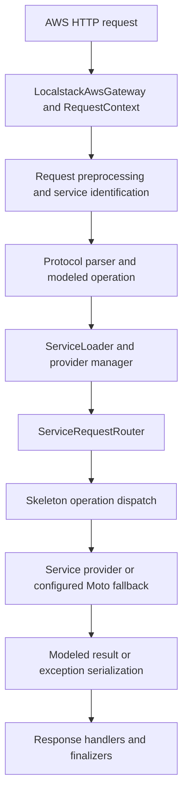

# LocalStack public engine: source investigation and first migration

Investigated **20 October 2026** against public repository revision **`8b9a79f05846835cf4dff63ab7eefdde9df83783`**. The [repository](https://github.com/localstack/localstack) is archived. Its public engine is spread across gateway, protocol, provider and state modules; there is no single file whose replacement supplies all LocalStack behavior.

This investigation reads actual source, rather than inferring implementation from feature names. Eighteen pinned files were retrieved and hashed. The [source manifest](research/localstack-source-manifest.json) records their paths, byte counts, SHA-256 hashes, Git blob IDs, definitions and permanent source links. This is a bounded source inspection, not an exhaustive repository or shipped-image audit. The upstream runtime was not executed: Rolo, Botocore, Moto, Werkzeug and Plux are not installed in the authoring environment.

The REA skill specifically routes ordinary analysis of complete source repositories to normal repository tools. No decompiler, proprietary artifact extraction or REA runtime capture was needed or performed for this public Python source investigation. Shell Git cloning failed because its network context could not resolve GitHub; pinned raw files were retrieved using the browser HTTP client instead. The inspected reference files live under `/tmp/localcloud-localstack-reference`; no upstream package is vendored into LocalCloud.

## What the public source establishes

| Finding                                                                                                                   | Direct source evidence                                                                                                                                                                                                                                                                                                                                                                                                                                                                                                                  | Meaning for this project                                                                                                                                                     |
| ------------------------------------------------------------------------------------------------------------------------- | --------------------------------------------------------------------------------------------------------------------------------------------------------------------------------------------------------------------------------------------------------------------------------------------------------------------------------------------------------------------------------------------------------------------------------------------------------------------------------------------------------------------------------------- | ---------------------------------------------------------------------------------------------------------------------------------------------------------------------------- |
| The engine uses ordered request, response, exception and finalization handlers.                                           | [`aws/app.py`, lines 14–104](https://github.com/localstack/localstack/blob/8b9a79f05846835cf4dff63ab7eefdde9df83783/localstack-core/localstack/aws/app.py#L14), [`aws/gateway.py`](https://github.com/localstack/localstack/blob/8b9a79f05846835cf4dff63ab7eefdde9df83783/localstack-core/localstack/aws/gateway.py).                                                                                                                                                                                                                   | A shared dispatch pipeline is a concrete architecture target. It does not by itself implement AWS protocols.                                                                 |
| A request context accumulates service, operation, protocol, account, region, request ID, input, result and exception.     | [`aws/api/core.py`, RequestContext](https://github.com/localstack/localstack/blob/8b9a79f05846835cf4dff63ab7eefdde9df83783/localstack-core/localstack/aws/api/core.py#L78).                                                                                                                                                                                                                                                                                                                                                             | Use one context across dispatch and tracing instead of disconnected metadata fields.                                                                                         |
| Service identification uses request indicators and a service catalog; parsing uses protocol/model information.            | [`aws/protocol/service_router.py`](https://github.com/localstack/localstack/blob/8b9a79f05846835cf4dff63ab7eefdde9df83783/localstack-core/localstack/aws/protocol/service_router.py#L360), [`aws/handlers/service.py`](https://github.com/localstack/localstack/blob/8b9a79f05846835cf4dff63ab7eefdde9df83783/localstack-core/localstack/aws/handlers/service.py#L29).                                                                                                                                                                  | Our existing manual S3/SQS/EC2 routing is much narrower. Header matching alone cannot establish full SDK compatibility.                                                      |
| Provider operations are routed through dispatch tables and skeletons; results/errors are serialized using service models. | [`aws/skeleton.py`](https://github.com/localstack/localstack/blob/8b9a79f05846835cf4dff63ab7eefdde9df83783/localstack-core/localstack/aws/skeleton.py#L121).                                                                                                                                                                                                                                                                                                                                                                            | Separate operation implementation from transport encoding. A handwritten table is only an initial step toward modeled validation/serialization.                              |
| Providers are loaded lazily and tracked through lifecycle states with locks and cached loading failures.                  | [`services/plugins.py`](https://github.com/localstack/localstack/blob/8b9a79f05846835cf4dff63ab7eefdde9df83783/localstack-core/localstack/services/plugins.py#L432), [`aws/handlers/service_plugin.py`](https://github.com/localstack/localstack/blob/8b9a79f05846835cf4dff63ab7eefdde9df83783/localstack-core/localstack/aws/handlers/service_plugin.py#L23).                                                                                                                                                                          | Service discovery/loading needs an explicit contract rather than arbitrary module imports in the HTTP handler.                                                               |
| Service state can be partitioned by account and region, with explicit shared attributes.                                  | [`services/stores.py`](https://github.com/localstack/localstack/blob/8b9a79f05846835cf4dff63ab7eefdde9df83783/localstack-core/localstack/services/stores.py).                                                                                                                                                                                                                                                                                                                                                                           | Our single SQLite resource namespace is not equivalent. Keeping account/region strings in a context does not implement isolation.                                            |
| The public repo contains an EC2 provider; its default registration uses a Moto fallback dispatcher.                       | [`services/providers.py`, EC2 registration](https://github.com/localstack/localstack/blob/8b9a79f05846835cf4dff63ab7eefdde9df83783/localstack-core/localstack/services/providers.py#L136), [`services/ec2/provider.py`](https://github.com/localstack/localstack/blob/8b9a79f05846835cf4dff63ab7eefdde9df83783/localstack-core/localstack/services/ec2/provider.py#L107), [`services/moto.py`](https://github.com/localstack/localstack/blob/8b9a79f05846835cf4dff63ab7eefdde9df83783/localstack-core/localstack/services/moto.py#L91). | “EC2 is paid, therefore no public EC2 code exists” was too broad. The inspected path establishes public EC2/Moto integration, not the paid Docker VM manager implementation. |

The public license is [Apache 2.0](https://github.com/localstack/localstack/blob/8b9a79f05846835cf4dff63ab7eefdde9df83783/LICENSE.txt). This migration references its architecture but does not import or copy the upstream implementation into the runtime.

## Traced upstream request path



This is a source-derived control-flow summary, not an observed execution trace. Specific services can add handlers, return direct responses or take other branches. The upstream gateway delegates its chain implementation to the separate Rolo package; that dependency's implementation was not part of the inspected file set.

## What changed in LocalCloud

Before this migration, HTTP branches called `Engine.sqs`, `Engine.s3` or `EC2.call` directly. Now supported AWS-wire requests and authenticated dashboard service requests enter a common gateway:

```text
Existing HTTP parsing and management authentication
  → RequestContext
  → validate_context
  → lazy provider adapter loading
  → explicit operation dispatch
  → existing S3/SQS/EC2 implementation, IAM, faults and SQLite
  → existing HTTP serialization
```

Implemented pieces:

- [`localcloud/gateway.py`](../localcloud/gateway.py): request context, ordered request handlers, response/error/finalizer hooks and thread-local context cleanup.
- [`localcloud/providers.py`](../localcloud/providers.py): explicit operation tables and one-time, synchronized provider adapter factories with available/starting/running/error state.
- [`localcloud/__main__.py`](../localcloud/__main__.py): routes supported wire/dashboard service calls through that gateway. Management operations stay separate and retain their bearer checks.
- [`localcloud/tooling.py`](../localcloud/tooling.py): service traces include the gateway's request ID, protocol and current account/region fields. Response headers and EC2 Query XML use the same request ID.
- [`localcloud/cli.py`](../localcloud/cli.py): `localcloud engine status` shows routing stages, provider states and the exact source reference.

Lazy loading currently applies to **adapters**. The existing Engine database and EC2 implementation object are still initialized at startup. There is no Plux plugin installation or arbitrary provider discovery yet. Existing Python service entry points remain callable directly for compatibility. No database schema or stored-resource migration is required for this step.

The new module structure and integration are LocalCloud code informed by verified upstream source. This is a first structural migration, **not a port of the entire upstream engine, recovery of private source, or an exact LocalStack compatibility claim**. All existing service-subset limitations still apply.

## Inspect the running engine

Restart the LocalCloud server with your existing database/token/image mappings, then use its already configured endpoint:

```bash
localcloud engine status
localcloud sqs list-queues
localcloud engine status
```

Initially an unused adapter is `available`; after a supported service request it becomes `running`. Inspecting engine metadata alone does not load it. The equivalent protected HTTP route is `GET /_local/engine`. Its source reference explicitly reports `exactParity: false` and `upstreamRuntimeExecuted: false`.

## Reproduce the source evidence

With a checkout of the public repository:

```bash
git clone https://github.com/localstack/localstack.git /tmp/localstack-reference
git -C /tmp/localstack-reference checkout 8b9a79f05846835cf4dff63ab7eefdde9df83783
python3 scripts/inspect-localstack-source.py \
  --source /tmp/localstack-reference \
  --verify docs/research/localstack-source-manifest.json
```

The verifier checks the exact inspected file set and SHA-256 hashes. It does not execute upstream code or treat matching file hashes as matching runtime behavior. Pass `--output /tmp/source-inspection.json` without `--verify` to regenerate a source inventory with definition line references.

## Remaining work before an exactness claim

| Area                              | Current evidence / next requirement                                                                                                                                                                                       |
| --------------------------------- | ------------------------------------------------------------------------------------------------------------------------------------------------------------------------------------------------------------------------- |
| Protocol models and serializers   | Source shows Botocore-based machinery. Integrate and test operation shapes, errors, XML/JSON details and service routing before claiming SDK compatibility. Existing codecs remain manual.                                |
| Rolo chain semantics              | Upstream is a wrapper over Rolo. Our handler lists do not establish identical short-circuit, error recovery or finalizer semantics. Inspect/pin that dependency if an actual port is selected.                            |
| Account/region identity and state | Implement actual namespace extraction and isolated stores, with legacy-state migration tests. Currently only one fixed account/region is supported.                                                                       |
| Provider lifecycle                | Adapter loading is implemented. Upstream start/check/stop hooks, disabled-service behavior, discovery and shutdown semantics remain broader.                                                                              |
| EC2 runtime                       | Public Moto registration was traced. No paid Docker VM manager artifact was inspected, and our container adapter is not proven equivalent.                                                                                |
| Runtime comparison                | Run a pinned upstream version and compare representative raw requests, response shapes, errors, state transitions and restart behavior. Existing tests compare LocalCloud with its own contracts, not upstream execution. |
| S3/SQS service behavior           | Public provider files were retrieved for boundary inspection, not exhaustively reconstructed. Existing LocalCloud subsets remain in place.                                                                                |

Current validation: **130 tests pass**, including provider loading under concurrency, factory errors, pipeline hooks/context isolation, existing persistence and service contracts, authenticated engine introspection and request-ID correlation across HTTP/XML/traces. Source identity verification covers all 18 inspected files. These results establish the migration's local behavior, not complete compatibility with LocalStack.
