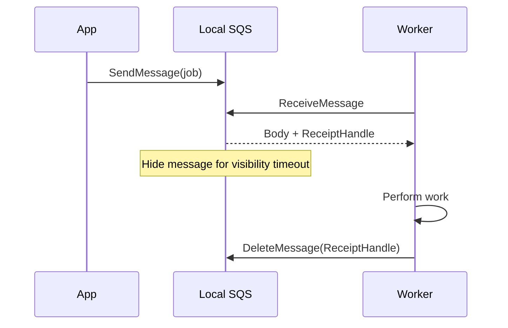
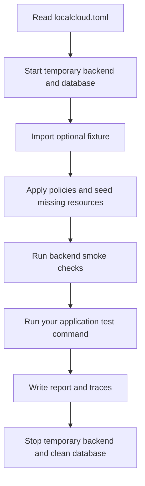
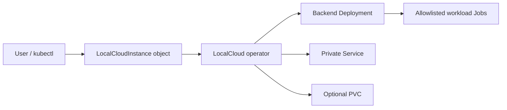
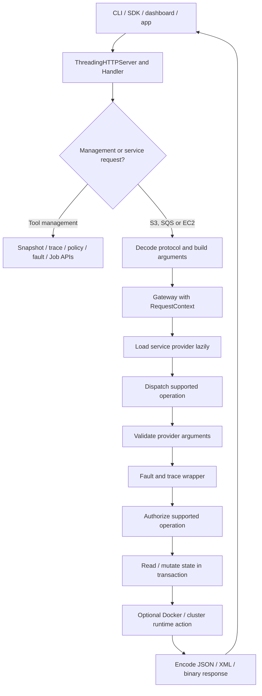
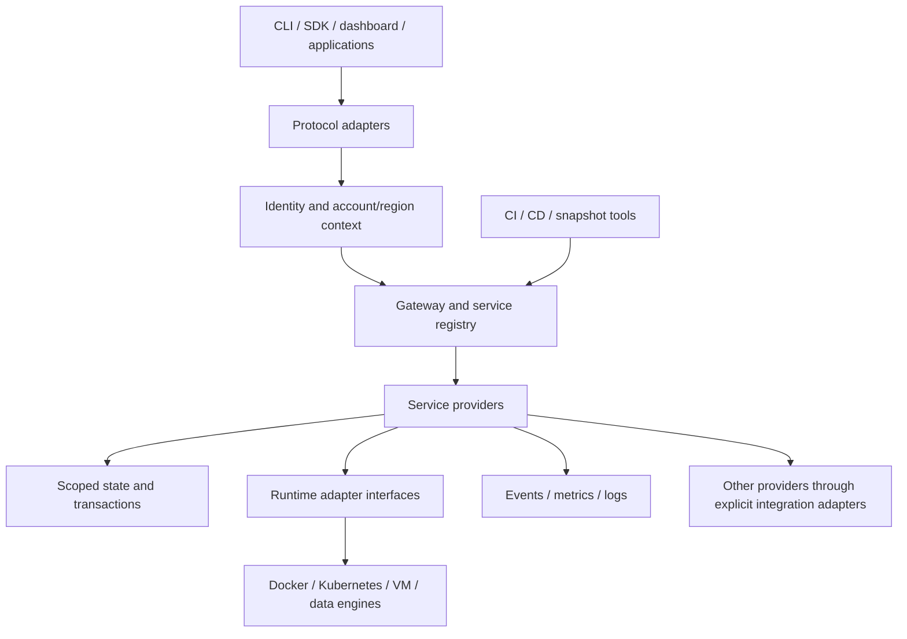

# LocalCloud handbook

A practical guide for people using LocalCloud and contributors building its
future services, add-ons and independent components. Chapters 1–25 describe the
current project at the 20 October 2026 EC2 checkpoint. Chapters 26–33 define
proposed contributor contracts and acceptance scenarios; they are not implemented
features or runnable current configuration. Examples use Linux/macOS-style shells.
Paths, image names and IDs marked REPLACE must be changed for your environment.

**Using LocalCloud:** begin at chapter 1. **Building a future service/component:**
read chapters 21–22 for the current engine, then chapters 26–33 for ownership,
interfaces, all 51 service build cards, worked implementation planning and release
criteria.

## Contents

1. [What LocalCloud does](#1-what-localcloud-does)
2. [Choose your workflow](#2-choose-your-workflow)
3. [Install and check prerequisites](#3-install-and-check-prerequisites)
4. [Start your first server](#4-start-your-first-server)
5. [Endpoints, profiles and tokens](#5-endpoints-profiles-and-tokens)
6. [Use the dashboard](#6-use-the-dashboard)
7. [Store files with S3](#7-store-files-with-s3)
8. [Process jobs with SQS](#8-process-jobs-with-sqs)
9. [Integrate a real Node.js application](#9-integrate-a-real-nodejs-application)
10. [Integrate Python without an AWS SDK](#10-integrate-python-without-an-aws-sdk)
11. [Use AWS CLI and SDK clients](#11-use-aws-cli-and-sdk-clients)
12. [Run local CI in your own project](#12-run-local-ci-in-your-own-project)
13. [Use Go and multiple quality checks](#13-use-go-and-multiple-quality-checks)
14. [Run local EC2 workloads](#14-run-local-ec2-workloads)
15. [Images, templates and volumes](#15-images-templates-and-volumes)
16. [Test IAM permissions](#16-test-iam-permissions)
17. [Save and restore state](#17-save-and-restore-state)
18. [Inspect requests and inject failures](#18-inspect-requests-and-inject-failures)
19. [Run LocalCloud in Docker](#19-run-localcloud-in-docker)
20. [Use Kubernetes](#20-use-kubernetes)
21. [Understand the core engine](#21-understand-the-core-engine)
22. [Develop and extend the project](#22-develop-and-extend-the-project)
23. [Troubleshoot common problems](#23-troubleshoot-common-problems)
24. [Operating limits and cleanup](#24-operating-limits-and-cleanup)
25. [Recipes and further reading](#25-recipes-and-further-reading)
26. [Contributor guide to the future project](#26-contributor-guide-to-the-future-project)
27. [The future architecture and component contracts](#27-the-future-architecture-and-component-contracts)
28. [How a contributor defines and delivers a feature](#28-how-a-contributor-defines-and-delivers-a-feature)
29. [Independent services and reusable backends to build](#29-independent-services-and-reusable-backends-to-build)
30. [Build specifications for all 51 screenshot services](#30-build-specifications-for-all-51-screenshot-services)
31. [Worked contributor example: build DynamoDB in useful slices](#31-worked-contributor-example-build-dynamodb-in-useful-slices)
32. [Platform features contributors can build independently](#32-platform-features-contributors-can-build-independently)
33. [Contribution sequencing, handoff and release claims](#33-contribution-sequencing-handoff-and-release-claims)

## 1. What LocalCloud does

LocalCloud runs a small set of AWS-like services on your development machine.
Your application sends a request to a local server instead of creating a real
cloud resource. That lets you develop and test without requiring a real AWS
account for the supported workflows.

For example, a document application can upload a file to local S3, put a job in
local SQS, process it, and save a result. LocalCloud supplies the storage and queue;
your application still supplies the business logic and tests.

LocalCloud is independently written. It does not require a LocalStack subscription
or token to run. Some architecture and EC2 behavior were studied using public
source and normally licensed REA reference captures. This does not make LocalCloud
a copy of every LocalStack service or establish full compatibility.

### What is available now

| Area                       | Working scope                                                                                   | Important boundary                                                                    |
| -------------------------- | ----------------------------------------------------------------------------------------------- | ------------------------------------------------------------------------------------- |
| S3                         | Bucket/object creation, binary transfer, listing and deletion.                                  | Small path-style subset; no multipart, versioning or full S3 policy/signing behavior. |
| SQS                        | Queues, sending/receiving, acknowledgement, visibility, delay, attributes and purge.            | JSON protocol subset; no FIFO, DLQs, batching or long polling.                        |
| EC2                        | 97 selected AWS operations plus a naming extension; mock state or allowlisted Docker execution. | A registered handler is not support for every parameter or every execution mode.      |
| Local CI                   | Temporary backend, application test command, S3/SQS setup, fixtures and reports.                | Does not deploy your application or automatically inspect its source for correctness. |
| Kubernetes                 | LocalCloud operator/CRD, bounded Jobs and EC2 Deployment/Service/PVC execution.                                 | EKS and Lambda/ECS adapters remain planned; see [EC2 Kubernetes](EC2_KUBERNETES.md).                                 |
| Developer tools            | IAM subset, snapshots/import/export, traces, policy proposals and operation faults.             | Local test tooling with documented limits.                                            |
| Dashboard                  | Connect to a running server and manage supported resources/tools.                               | A page cannot manage resources until a backend is reachable.                          |
| CD and other AWS providers | Planned work described in the roadmap.                                                          | Do not add unimplemented services to config and expect them to exist.                 |

The [service roadmap](SERVICE_IMPLEMENTATION_ROADMAP.md) covers all 51 screenshot
services. The [feature ledger](FEATURES.md) records implementation scope. Neither
is a promise that all listed roadmap services run today.

### Terms in plain words

| Term             | Meaning here                                                                                                                                            |
| ---------------- | ------------------------------------------------------------------------------------------------------------------------------------------------------- |
| Server/backend   | The running Python process that accepts requests and owns the state database.                                                                           |
| Endpoint         | The server's address, such as http://127.0.0.1:4566.                                                                                                    |
| Instance         | Depending on context: a LocalCloud server environment, an emulated EC2 resource, or a LocalCloudInstance Kubernetes object. These are different things. |
| Provider         | The code implementing one service's operations, such as SQS.                                                                                            |
| State            | The resources and data the server remembers.                                                                                                            |
| Profile          | A saved CLI endpoint, principal and optional token.                                                                                                     |
| Principal        | The local caller name used for policy testing; default test.                                                                                            |
| Management token | A local password-like value protecting management operations.                                                                                           |
| Mock EC2         | An instance record with lifecycle state; no application executes.                                                                                       |
| Docker EC2       | An instance record backed by a real local container.                                                                                                    |
| Receipt handle   | The acknowledgement token returned when SQS delivers a message.                                                                                         |
| Fixture          | A saved initial state used to make a test repeatable.                                                                                                   |

## 2. Choose your workflow

| Your goal                                    | Start here      | Do you need an already running server?                 |
| -------------------------------------------- | --------------- | ------------------------------------------------------ |
| Learn S3/SQS or use the dashboard            | Sections 4–8.   | Yes.                                                   |
| Add cloud-like dependencies to your app      | Sections 9–11.  | Yes for manual development; CI manages its own server. |
| Run tests from your app directory            | Sections 12–13. | No; local CI starts an isolated backend.               |
| Deploy a local web app into an EC2 container | Sections 14–15. | Yes, started with Docker image mappings.               |
| Run LocalCloud or a job inside Kubernetes    | Section 20.     | The cluster and operator/instance must exist first.    |
| Understand or change the engine              | Sections 21–22. | Source inspection needs no server; runtime checks do.  |

For your first attempt, use a host Python server and the CLI. Docker and
Kubernetes are optional; they are not required for S3/SQS or ordinary local CI.

## 3. Install and check prerequisites

### Basic requirements

- Python 3.11 or newer.
- A checkout of this project.
- A terminal. The normal Python backend has no third-party runtime packages.

Additional requirements depend on the workflow:

| Workflow            | Additional tools                                                                      |
| ------------------- | ------------------------------------------------------------------------------------- |
| Node example        | Node.js 22+ and npm. The included example has no npm package dependencies.            |
| Go example          | Go installed locally.                                                                 |
| Docker EC2          | Docker CLI, a running daemon and permission to use it; allowed local workload images. |
| Generated SSH keys  | ssh-keygen on the server; ssh on the client for SSH access.                           |
| Kubernetes          | kubectl and a working cluster; kind only if you choose to create a kind cluster.      |
| AWS client examples | AWS CLI or Boto3 installed separately; not needed for the LocalCloud CLI.             |

Check Python and enable the CLI from the repository root:

```bash
python3 --version
export PATH="$PWD/bin:$PATH"
localcloud --help
```

For a persistent checkout launcher:

```bash
python3 scripts/install-cli.py
export PATH="$HOME/.local/bin:$PATH"
localcloud --help
```

This installs a launcher that imports this checkout. Keep the checkout in place.
Moving or deleting it breaks that launcher. The installer does not edit your
shell startup files; add the PATH setting yourself if you want it in new terminals.

Alternatively use an editable Python installation inside a virtual environment:

```bash
python3 -m venv .venv
. .venv/bin/activate
python3 -m pip install -e .
localcloud --help
```

The checkout launcher makes the CLI available from other directories, but does
not install the Python package into every Python interpreter. Use the virtual
environment installation if another Python program needs to import localcloud.

## 4. Start your first server

Use two terminals. Terminal A runs the server; terminal B runs client commands.

### Terminal A — start

From the project root:

```bash
localcloud start --instance-name dev --host 127.0.0.1 --port 4566 \
  --data .localcloud/dev.sqlite3
```

Leave this process running. Its dashboard is at http://127.0.0.1:4566/_local.
This initial example has no management token and is intended for local use.
For authenticated use, follow section 5 before creating your real development setup.

### Terminal B — connect and check

```bash
localcloud configure --endpoint-url http://127.0.0.1:4566
localcloud status
localcloud resources
localcloud engine status
```

`status` confirms health. `resources` checks access to the resource overview.
`engine status` shows the gateway/provider configuration. Health alone does not
prove that a saved management token is valid.

The connection is a client setting. The server does not start because you run
`configure`, and changing that setting does not change its listening port.

### Stop and restart

Press Ctrl+C in terminal A. Restart using the same command and database path to
recover resources. The data path is relative to the server's working directory,
so starting from another directory with the same relative spelling can create a
different database. Use an absolute path when consistency matters.

Use one server process per database. A second server should have its own port
and database:

```bash
localcloud start --instance-name other --port 4567 \
  --data .localcloud/other.sqlite3
```

## 5. Endpoints, profiles and tokens

### Use one token across restarts

Stop the initial server before replacing it with the authenticated one. Create a
private token file only if you do not already have one:

```bash
mkdir -p ~/.config/localcloud
if [ ! -s ~/.config/localcloud/server-token ]; then
  (umask 077; python3 -c 'import secrets; print(secrets.token_urlsafe(32))' \
    > ~/.config/localcloud/server-token)
fi
export LOCALCLOUD_MANAGEMENT_TOKEN="$(cat ~/.config/localcloud/server-token)"
localcloud start --instance-name dev --port 4566 --data .localcloud/dev.sqlite3
```

The file is a convention used by these examples. The server reads the exported
environment variable; it does not automatically discover this file. Generating
another random token before every start changes the server credential.

In terminal B:

```bash
unset LOCALCLOUD_MANAGEMENT_TOKEN
localcloud configure --endpoint-url http://127.0.0.1:4566
cat ~/.config/localcloud/server-token | localcloud auth login --token-stdin
localcloud auth status
localcloud resources
```

The token's value is the long random string inside the file. Typing the words
`LOCALCLOUD_MANAGEMENT_TOKEN` at a password prompt does not supply that value.

A saved login and an exported token can conflict: the CLI prefers the exported
`LOCALCLOUD_MANAGEMENT_TOKEN`. Unset an old exported value when using saved login.
`auth status` describes saved/client authentication settings; a successful
`resources` request verifies protected access to the running server.

### Use named profiles

```bash
localcloud configure --profile dev --endpoint-url http://127.0.0.1:4566
cat ~/.config/localcloud/server-token | localcloud auth login --profile dev --token-stdin
localcloud status --profile dev
localcloud resources --profile dev

localcloud configure --profile second --endpoint-url http://127.0.0.1:4567
localcloud status --profile second
```

Authenticate each profile if its target server requires a token. Profiles do not
create additional AWS accounts or regions; they select separate server endpoints.

The default profile file is normally ~/.config/localcloud/config.json. XDG config
settings, LOCALCLOUD_CONFIG and --config-file can change its location. Tokens are
stored privately; do not commit the file.

### Endpoint selection

For normal service CLI commands, the selection order is:

1. Explicit --endpoint-url.
2. LOCALCLOUD_URL.
3. LOCALCLOUD_ENDPOINT_URL.
4. Saved profile endpoint.
5. http://127.0.0.1:4566.

Environment endpoint settings override saved endpoints even with a named
profile. When switching from an app shell to profile-based administration, clear
the overrides you no longer want:

```bash
unset LOCALCLOUD_URL LOCALCLOUD_ENDPOINT_URL LOCALCLOUD_PRINCIPAL
```

The principal similarly uses --principal, then LOCALCLOUD_PRINCIPAL, then the
profile/default. The supported region is us-east-1; a different flag does not
create region isolation.

### Three credentials that are easy to confuse

| Credential                   | Purpose                                                                                                         |
| ---------------------------- | --------------------------------------------------------------------------------------------------------------- |
| LocalCloud management token  | Protects management APIs; required for Docker EC2 and Kubernetes execution.                                     |
| LocalStack auth token        | Only needed when deliberately running a licensed LocalStack reference for research. Not used to run LocalCloud. |
| Dummy AWS access/secret keys | Satisfy SDK configuration; they are not real cloud credentials or IAM sessions.                                 |

Management authentication and workload IAM tests are separate. Raw S3/SQS routes
are not protected merely by enabling a management token. The IAM subset uses a
caller header, not verified AWS signatures. Keep this a private development tool.

## 6. Use the dashboard

1. Start the server.
2. Open its own /\_local URL, such as http://127.0.0.1:4566/_local.
3. Check the endpoint and enter the management token if required.
4. Click Connect.
5. Choose EC2, S3, SQS or a developer-tool view.

The browser token stays in page memory. It is not saved as your CLI profile or
restored from the CLI token file. Refreshing the page may require reconnecting.
Changing endpoints can open the other server's page; enter that server's token.

You can create buckets, upload/download objects, create queues, send/receive and
acknowledge messages. EC2 controls cover supported launch/lifecycle operations
and selected infrastructure operations. CLI-only APIs still exist; do not assume
every one of the 97 EC2 operations has a dedicated dashboard form.

Disconnecting the page stops its management connection. It does not stop the
server or its Docker containers. See [the dashboard guide](DASHBOARD.md) for
screen-specific behavior.

## 7. Store files with S3

Scenario: your app stores invoices and downloads them later.

Start with an IAM-off server, or install a policy permitting these actions in
section 16. In terminal B:

```bash
localcloud s3 mb s3://app-invoices
printf 'invoice 001: paid\n' > /tmp/invoice-001.txt
localcloud s3 cp /tmp/invoice-001.txt s3://app-invoices/invoices/001.txt
localcloud s3 ls s3://app-invoices
localcloud s3 cp s3://app-invoices/invoices/001.txt /tmp/invoice-downloaded.txt
cat /tmp/invoice-downloaded.txt
```

Expected result: the downloaded text matches the uploaded text. The bucket is
`app-invoices`; the object key is `invoices/001.txt`. Slashes in a key represent a
name, not real nested directories on your host.

Cleanup:

```bash
localcloud s3 rm s3://app-invoices/invoices/001.txt
localcloud s3 rb s3://app-invoices
```

Bucket deletion fails while the bucket still contains objects. `cp` is a
single-object transfer, not a recursive directory synchronizer.

The high-level s3 commands hide protocol details. The lower-level CLI includes
s3api operations; inspect `localcloud s3api --help` for exact flags.

Current limits include path-style addressing, a small API subset and an 8 MiB
request-body limit. Binary object data is stored as base64 in the database's JSON
state. Management JSON/base64 adds overhead, so do not assume an 8 MiB source file
fits every transfer route. The dashboard applies a 5 MiB upload limit.

## 8. Process jobs with SQS

Scenario: an app creates a background job and a worker picks it up.

```bash
localcloud sqs create-queue --queue-name invoice-jobs
localcloud sqs send-message --queue-name invoice-jobs \
  --message-body '{"invoice":"001","task":"generate-pdf"}'
localcloud sqs receive-message --queue-name invoice-jobs
```

The response includes the message body, message ID and ReceiptHandle. Copy the
receipt handle from that delivery and acknowledge only after work succeeds:

```bash
localcloud sqs delete-message --queue-name invoice-jobs \
  --receipt-handle 'REPLACE_WITH_RECEIPT_HANDLE'
```

A receipt handle is not the message ID. A later delivery gets a new receipt.



If the worker crashes before deletion, the message becomes available after its
visibility timeout. Receiving is not acknowledgement, and an empty second receive
can simply mean the first worker is still holding the message.

Useful commands:

```bash
localcloud sqs get-queue-attributes --queue-name invoice-jobs --attribute-names All
localcloud sqs set-queue-attributes --queue-name invoice-jobs \
  --attributes '{"VisibilityTimeout":"60"}'
localcloud sqs receive-message --queue-name invoice-jobs --visibility-timeout 60
```

Queue names can be used instead of remembering queue URLs. Apps should resolve
GetQueueUrl and use the returned QueueUrl as an identifier. The QueueUrl advertises
the server's public endpoint; see Kubernetes networking notes in section 20.

`purge-queue` removes messages and `delete-queue` removes the queue. These are
cleanup commands for resources you own, not a routine step while another worker
is processing jobs.

## 9. Integrate a real Node.js application

### What the included example does

The runnable app lives in examples/node-app. It accepts document text, stores it
in S3, sends an SQS message, lets a worker uppercase the text, stores the result
in S3, then acknowledges the message.

```text
submit document
    -> S3: documents/demo1.txt
    -> SQS: { id, key }
worker receives job
    -> reads S3 input
    -> applies business logic
    -> S3: results/demo1.txt
    -> deletes delivered SQS message
```

### Run its tests without a manually running server

From the LocalCloud repository root:

```bash
cd examples/node-app
node --version
localcloud ci
```

The example already has package.json, tests, policy files and localcloud.toml.
Its npm test command uses Node's built-in test runner. No npm install is required
for this example. Other apps must install their own dependencies first.

CI will start its own temporary server, apply the example policies, create the
bucket/queue, run tests and write artifacts/localcloud/report.json under this app.
It does not use your persistent development database.

### Run the app manually against your server

In your client terminal, connect to the intended server and prepare resources:

```bash
localcloud s3 mb s3://app-documents
localcloud sqs create-queue --queue-name app-jobs
```

The manual resource setup above assumes IAM off or a setup principal already
authorized to create those resources. For enforce mode, use section 16 to grant
an explicit setup policy first, then install the example policy for principal app:

```bash
localcloud iam put-policy --user-name app \
  --policy-document file://examples/node-app/ci/policies/app.json
```

That relative path assumes the LocalCloud repository root. From inside the
example directory use file://ci/policies/app.json instead.

From examples/node-app, run:

```bash
export LOCALCLOUD_URL=http://127.0.0.1:4566
export LOCALCLOUD_PRINCIPAL=app
export LOCALCLOUD_MANAGEMENT_TOKEN="$(cat ~/.config/localcloud/server-token)"
export DOCUMENTS_BUCKET=app-documents
export JOBS_QUEUE=app-jobs
npm start -- submit demo1 'hello from my application'
npm start -- work
localcloud s3 cp s3://app-documents/results/demo1.txt /tmp/demo1-result.txt
cat /tmp/demo1-result.txt
```

Expected result: `HELLO FROM MY APPLICATION`. For an unauthenticated server,
management-token setup is unnecessary; the app's ordinary S3/SQS requests use
its local principal. If resources already exist, inspect them rather than
blindly recreating them with conflicting attributes.

`npm start -- work` processes at most one message. It is not a continuously
running worker or scheduler. If no message is available, the process returns null.

### Adapt it to your own app

1. Copy or adapt the small examples/node-app/src/localcloud.mjs transport adapter.
2. Read endpoint and caller settings from environment variables.
3. Keep business logic separate from storage/queue calls, as app.mjs does.
4. Make workers acknowledge only after successful output storage.
5. Add unit tests for business logic and integration tests for cloud interactions.
6. Put localcloud.toml in your application's root and run CI there.

The adapter is specific to the supported emulator APIs. It is not a production
AWS SDK. Use a separate production adapter if your app also targets real AWS.
The full [Node tutorial](NODEJS_LOCAL_CI.md) describes its integration scenarios.

## 10. Integrate Python without an AWS SDK

Scenario: a Python process needs the current local queue APIs, but you do not
want another package dependency. Create a standalone app directory and save the
following as queue_demo.py. This calls the supported JSON protocol directly; it
does not need to import the LocalCloud Python package.

```python
import json
import os
import urllib.request

endpoint = os.environ["LOCALCLOUD_URL"].rstrip("/")
principal = os.environ.get("LOCALCLOUD_PRINCIPAL", "test")
# Avoid sending local requests through an inherited HTTP proxy.
opener = urllib.request.build_opener(urllib.request.ProxyHandler({}))


def sqs(action, **parameters):
    request = urllib.request.Request(
        endpoint + "/",
        data=json.dumps(parameters).encode(),
        headers={
            "Content-Type": "application/x-amz-json-1.0",
            "X-Amz-Target": "AmazonSQS." + action,
            "X-Local-Principal": principal,
        },
        method="POST",
    )
    with opener.open(request, timeout=10) as response:
        return json.load(response)


queue = sqs("GetQueueUrl", QueueName="invoice-jobs")["QueueUrl"]
sqs("SendMessage", QueueUrl=queue, MessageBody="hello from Python")
response = sqs("ReceiveMessage", QueueUrl=queue, MaxNumberOfMessages=1)
for message in response.get("Messages", []):
    print(message["Body"])
    sqs("DeleteMessage", QueueUrl=queue, ReceiptHandle=message["ReceiptHandle"])
```

Prepare invoice-jobs using section 8, then:

```bash
export LOCALCLOUD_URL=http://127.0.0.1:4566
export LOCALCLOUD_PRINCIPAL=test
python3 queue_demo.py
```

The script reads a shared queue, so another consumer can receive the message
first. Give a test its own queue when it needs deterministic ownership. An HTTP
error raises an exception; a real worker should decide what to retry and should
not acknowledge failed work.

For management operations the request additionally needs
`Authorization: Bearer VALUE` when the server has a token. The Node adapter and
LocalCloud CLI already handle that distinction.

## 11. Use AWS CLI and SDK clients

LocalCloud's own CLI is the simplest path. AWS CLI/Boto3 are optional and must be
installed separately. Compatibility is per operation, not a blanket drop-in claim.

For the tested EC2 Query path:

```bash
export AWS_ACCESS_KEY_ID=test
export AWS_SECRET_ACCESS_KEY=test
export AWS_DEFAULT_REGION=us-east-1
export AWS_SESSION_TOKEN="$(cat ~/.config/localcloud/server-token)"
aws --endpoint-url http://127.0.0.1:4566 ec2 describe-images
aws --endpoint-url http://127.0.0.1:4566 ec2 describe-instances
```

For Docker EC2, LocalCloud uses the supplied session-token header to verify the
local management token. It does not issue a real STS session. For an unauthenticated
mock server, a session token is not necessary. These exports affect that shell;
use a dedicated local-development shell rather than mixing local and real AWS work.

Boto3 example after installing Boto3 in your application's environment. Set
LOCALCLOUD_URL to the intended backend and LOCALCLOUD_MANAGEMENT_TOKEN to its
existing token when using Docker EC2:

```python
import os
import boto3

client = boto3.client(
    "ec2",
    endpoint_url=os.environ["LOCALCLOUD_URL"],
    region_name="us-east-1",
    aws_access_key_id="test",
    aws_secret_access_key="test",
    aws_session_token=os.environ.get("LOCALCLOUD_MANAGEMENT_TOKEN"),
)
print(client.describe_instances()["Reservations"])
```

Always set endpoint_url explicitly in examples that could otherwise reach a real
service. Some S3 SDK releases attach query parameters/checksums the limited S3
handler does not implement; setting an endpoint does not make every SDK operation
compatible. See the service guides and contract tests for supported paths.

## 12. Run local CI in your own project

### Where the configuration belongs

Put localcloud.toml beside your app's package.json, go.mod or Python project
files. Do not put your Node test command in the LocalCloud repository root unless
that directory actually contains the Node app you mean to test.

```text
my-app/
  package.json
  localcloud.toml
  src/
  test/
  ci/
    policies/
      app.json
```

LocalCloud CI does not need GitHub workflow files or a hosted CI account.

### Initialize and run

In your application's root:

```bash
localcloud ci init --command npm test
localcloud ci
```

The initializer refuses to overwrite an existing file. Edit it intentionally
rather than rerunning initialization. A minimal valid config is:

```toml
version = 1

[ci]
command = ["npm", "test"]
services = ["s3", "sqs"]
iam = "soft"
timeout = 300
artifacts = "artifacts/localcloud"
```

Commands are argument arrays, not shell strings. This runs npm with the argument
test. Writing `["npm test"]` asks the system for an executable literally named
`npm test` and will fail.

### Full application configuration

```toml
version = 1

[ci]
command = ["npm", "test"]
services = ["s3", "sqs"]
iam = "enforce"
principal = "app"
timeout = 120
artifacts = "artifacts/localcloud"
export_state = false

[ci.seed]
buckets = ["app-documents"]
queues = ["app-jobs"]

[ci.policy_files]
app = "ci/policies/app.json"

[ci.env]
DOCUMENTS_BUCKET = "app-documents"
JOBS_QUEUE = "app-jobs"
```

Create the referenced JSON policy file before running this config. The repository
example includes one you can inspect and adapt. Keep paths relative to the config
file unless intentionally using an absolute path.

Important current parser rules:

- ci.services accepts only s3 and sqs. EC2 exists in the backend but is not a
  selectable CI setup service in this config format yet.
- ci.seed supports bucket names and queue names, not arbitrary infrastructure.
- ci.env values must be strings. It cannot override reserved LOCALCLOUD* or AWS*
  variables; use ci.principal for the caller identity.
- The supported top-level tables are version and ci. There is no cd or stages
  configuration parser yet. Do not copy proposed roadmap syntax into a real file.
- services declares supported dependencies. It does not turn the other registered
  providers off or change the built-in S3/SQS smoke checks.

### What happens when you run CI



The runner sets environment variables for the child test process:

| Variable                                  | Meaning                                                                |
| ----------------------------------------- | ---------------------------------------------------------------------- |
| LOCALCLOUD_URL / AWS_ENDPOINT_URL         | Temporary endpoint on a free port; read it instead of hardcoding 4566. |
| LOCALCLOUD_PRINCIPAL                      | Caller from ci.principal, default test.                                |
| LOCALCLOUD_MANAGEMENT_TOKEN               | Per-run token for protected management operations.                     |
| LOCALCLOUD_CI                             | 1 during this run.                                                     |
| AWS_DEFAULT_REGION                        | us-east-1.                                                             |
| AWS_ACCESS_KEY_ID / AWS_SECRET_ACCESS_KEY | Dummy test values.                                                     |
| Your ci.env variables                     | Application resource names and other string settings.                  |

The runner sets dummy access and secret keys for the child. It does not clear
every inherited SDK setting, such as AWS_SESSION_TOKEN or AWS_PROFILE; use a
dedicated local-test environment rather than assuming full credential isolation.
It does not intercept all network traffic. Your application must actually honor the
local endpoint. Do not expect a normal SDK's automatic credential lookup to
become a full IAM/STS emulation.

Your test runner starts and stops your app process if necessary. LocalCloud only
manages its temporary emulator. Use a finite test command with assertions, not
`npm start` for a web server that never exits.

### Read the result

```text
artifacts/localcloud/report.json
artifacts/localcloud/traces.json
artifacts/localcloud/state.json    # only if export_state = true
```

The report says whether smoke checks and your application command passed. It
includes command_exit_code, application_tests, error and duration. A successful
backend health check does not prove that your app passed; inspect application_tests.

With no config and no explicit command, localcloud ci checks the backend only.
The report labels app tests not_configured. It does not automatically locate or
test arbitrary source files.

Useful overrides:

```bash
localcloud ci -- npm run test:unit
localcloud ci --config /absolute/path/to/my-app/localcloud.toml
localcloud ci --timeout 180 --artifacts artifacts/debug-run
localcloud ci --export-state
localcloud ci --no-config
```

Configuration discovery checks the current directory, not every parent directory.
CLI command/setting overrides take precedence. Config-relative paths belong to
the app root; explicitly supplied CLI paths belong to your current directory.

### Reuse a fixture

On the intended running development server:

```bash
mkdir -p ci
localcloud state export ci/baseline.json
```

Then add `fixture = "ci/baseline.json"` inside the ci table. Import happens before
policy overrides and seeding. Each run gets an independent database; the fixture
and original development instance are not changed by the runner.

### CI is not CD

The current runner can call your existing script, so that script could explicitly
invoke external deployment tools you write. That is not a built-in CD service.
LocalCloud currently has no managed release history, deployment health/rollback
controller or supported cd TOML table. See [the roadmap](FEATURES.md) before
planning automated deployment around those features.

## 13. Use Go and multiple quality checks

Scenario: you have a Go application and want format, analysis, unit tests and a
build. Install Go yourself; LocalCloud does not install compilers.

In a scratch directory:

```bash
mkdir localcloud-go-demo
cd localcloud-go-demo
go mod init example.com/localcloud-go-demo
mkdir -p ci
```

Create main.go:

```go
package main

import (
    "fmt"
    "strings"
)

func Normalize(value string) string {
    return strings.ToUpper(strings.TrimSpace(value))
}

func main() {
    fmt.Println(Normalize(" hello from Go "))
}
```

Create main_test.go:

```go
package main

import "testing"

func TestNormalize(t *testing.T) {
    if got := Normalize(" hello "); got != "HELLO" {
        t.Fatalf("got %q, want HELLO", got)
    }
}
```

Create ci/check.sh:

```bash
#!/bin/sh
set -eu
if [ -n "$(gofmt -l main.go main_test.go)" ]; then
  echo 'Run gofmt -w main.go main_test.go before committing.' >&2
  exit 1
fi
go vet ./...
go test ./...
mkdir -p artifacts/build
go build -buildvcs=false -o artifacts/build/app .
```

Create the ci directory before saving that script. Run gofmt once after copying
the Go code, then create localcloud.toml:

```toml
version = 1

[ci]
command = ["sh", "ci/check.sh"]
services = ["s3", "sqs"]
iam = "soft"
timeout = 120
artifacts = "artifacts/localcloud"
```

```bash
gofmt -w main.go main_test.go
localcloud ci
./artifacts/build/app
```

Expected output from the built app: `HELLO FROM GO`. A failed quality check stops
the script and makes CI fail. These checks are provided by your script and Go's
tools; the current CI parser does not have native named stages.

The build disables optional Git/VCS stamping so the scratch example does not
require a usable Git checkout. You can choose a different build policy for your
real release process.

This first Go example tests application logic, not S3/SQS. To add cloud integration,
read LOCALCLOUD_URL in the application and use the JSON SQS/path-style S3 contract
from section 10, or a separately verified SDK adapter. Seed required resources in
TOML and assert the expected data/results in integration tests. A green backend
smoke check alone does not test your business logic.

## 14. Run local EC2 workloads

### Mock lifecycle first

Against an ordinary running server:

```bash
localcloud ec2 run-instances --image-id ami-local --name demo
localcloud ec2 describe-instances --name demo
localcloud ec2 stop-instances --name demo
localcloud ec2 start-instances --name demo
localcloud ec2 terminate-instances --name demo
```

Mock mode stores records and state transitions. It does not run your application.
Terminated instances cannot be restarted. Names remain reserved until renamed;
use a fresh name if you are repeating an example.

### Deploy the included web app through Docker EC2

From the repository root, build the app and optional helper:

```bash
docker build -t localcloud-ec2-web:dev examples/ec2-web
docker build -t localcloud:ec2-runtime .
```

Stop the earlier backend if it owns port 4566. In terminal A:

```bash
export LOCALCLOUD_MANAGEMENT_TOKEN="$(cat ~/.config/localcloud/server-token)"
localcloud start --instance-name ec2-dev --port 4566 \
  --data .localcloud/ec2-app.sqlite3 \
  --ec2-image ami-web=localcloud-ec2-web:dev \
  --ec2-helper-image localcloud:ec2-runtime --ec2-imds
```

In terminal B, authenticate to this endpoint using section 5, then:

```bash
localcloud ec2 describe-images
localcloud ec2 run-instances --image-id ami-web --name web \
  --publish 8088:8080 --timeout 60
localcloud ec2 describe-instances --name web
```

Open http://127.0.0.1:8088. Backend port 4566 is the management/cloud API. Published
port 8088 is your app; container port 8080 is where it listens internally.

```text
browser -> localhost:8088 -> managed container:8080
CLI     -> localhost:4566 -> LocalCloud engine -> Docker lifecycle
```

Your own image must run a long-lived compatible process and bind web listeners
to 0.0.0.0 inside the container. The normal profile uses a read-only root and UID
65534, so write application data into a supported attached volume or temporary
/tmp. A short command may exit immediately and leave a stopped instance.

Other useful commands:

```bash
localcloud ec2 get-console-output --name web
localcloud ec2 reboot-instances --name web --timeout 60
localcloud ec2 stop-instances --name web --timeout 60
localcloud ec2 modify-instance-attribute --name web --instance-type t3.small
localcloud ec2 start-instances --name web --timeout 60
```

Lifecycle selection supports an EC2 ID, valid name, managed container ID/name or
published host port. Use exactly one selector. An arbitrary unrelated Docker
container is not adopted by supplying its ID.

Stopping the LocalCloud server does not stop its managed containers. Restart the
same backend configuration to manage them again. Use terminate-instances for
intentional workload removal.

## 15. Images, templates and volumes

### Templates

Use a fresh mock instance name or an allowlisted Docker image appropriate to the
running server:

```bash
localcloud ec2 create-launch-template --launch-template-name app-template \
  --launch-template-data '{"ImageId":"ami-web","InstanceType":"t3.micro"}'
localcloud ec2 run-instances \
  --launch-template '{"LaunchTemplateName":"app-template","Version":"$Default"}' \
  --name template-web --publish 8089:8080 --timeout 60
```

Keep the JSON in single quotes so the shell does not expand $Default or $Latest.
Explicit launch flags override template defaults. The template API supports a
bounded subset of AWS fields; see [template usage](EC2_TEMPLATES.md).

### AMI root capture

For Docker instances without attached volumes:

```bash
localcloud ec2 stop-instances --name web --timeout 60
localcloud ec2 describe-instances --name web
localcloud ec2 create-image --instance-id i-REPLACE --name web-image --timeout 60
localcloud ec2 describe-images
localcloud ec2 run-instances --image-id ami-REPLACE --name image-web \
  --publish 8090:8080 --timeout 60
```

Use the actual instance ID from describe and ImageId from create-image. A Docker
capture requires the source to be stopped, verifies container ownership and
commits its root filesystem into an owned Docker image. It does not import a VM
image or include tmpfs/attached-volume contents. The mock path creates metadata.

Deregistering an owned Docker AMI requires terminating its active consumers first.
A registered mock snapshot-based AMI does not authorize an arbitrary Docker image.

### Volumes and snapshots

To launch with an application filesystem volume:

```bash
localcloud ec2 run-instances --image-id ami-web --name storage-web \
  --publish 8091:8080 \
  --block-device-mappings '[{"DeviceName":"/data","Ebs":{"VolumeSize":1,"DeleteOnTermination":false}}]' \
  --timeout 60
localcloud ec2 describe-volumes
```

The app can write under /data. Device-style /dev/sdf mappings become filesystem
mounts at /mnt/ebs/sdf, not raw devices. Do not run mkfs on these mappings.

```bash
localcloud ec2 stop-instances --name storage-web --timeout 60
localcloud ec2 create-snapshot --volume-id vol-REPLACE --description 'Before change' --timeout 60
localcloud ec2 copy-snapshot --source-region us-east-1 \
  --source-snapshot-id snap-REPLACE --description 'Fixture copy' --timeout 60
localcloud ec2 create-volume --availability-zone us-east-1a \
  --snapshot-id snap-REPLACE --timeout 60
```

Replace the returned IDs. Stop writers before Docker snapshotting for a consistent
file copy. Attach/detach requires a stopped Docker instance and recreates its
container: EC2 ID stays stable while container ID changes. A volume size is
metadata, not an enforced disk quota. DeleteOnTermination false requires explicit
volume cleanup after termination. Snapshots need their own deletion.

### SSH and metadata

An opt-in guest server profile supports root/writable guests with a trusted image
containing sshd, public-key SSH, and owned root preservation. It overrides the
image's original command. Do not casually add --ec2-guest-mode to an ordinary web
image server; follow [the guest walkthrough](EC2_INFRASTRUCTURE.md#ssh-into-an-os-like-guest).

With --ec2-imds and a helper image, each guest gets the standard link-local
metadata endpoint in its own network namespace. Supported IMDSv1/v2 exposes
instance metadata and user data; it does not issue IAM role credentials.

### Networking boundary

VPCs, subnets, groups, routes, secondary interfaces and EIP association APIs have
supported configuration behavior. They do not imply live AWS routing/firewalls,
additional guest NICs or EIP NAT. Use published endpoints for actual app access.
Read [networking evidence](EC2_NETWORKING.md) before writing security assertions.

The [release guide](EC2_RELEASE.md) and [infrastructure walkthrough](EC2_INFRASTRUCTURE.md)
cover further CLI operations, exact differences and cleanup order. Critical EC2
implementation work is separate from this documentation task.

## 16. Test IAM permissions

Scenario: a worker should read and write its application's objects, but a
read-only user must not upload anything.

IAM mode is selected when starting the server:

| Mode    | Behavior                                                             |
| ------- | -------------------------------------------------------------------- |
| off     | Allow supported operations without policy enforcement.               |
| soft    | Execute operations but record policy violations.                     |
| enforce | Reject operations without a matching allow or with an explicit deny. |

The evaluator supports Effect, Action and Resource, optional Sid, and wildcards.
It does not support the complete AWS policy language, role assumption or conditions.

### Bootstrap a controlled local test

For a separate permission exercise, start a server on a free port with its own
database and your existing exported token:

```bash
localcloud start --instance-name iam-demo --port 4567 \
  --data .localcloud/iam-demo.sqlite3 --iam enforce
```

This requires the token export in that server terminal if you want authenticated
management. In the client terminal, clear endpoint/principal overrides and configure the
isolated profile:

```bash
unset LOCALCLOUD_URL LOCALCLOUD_ENDPOINT_URL LOCALCLOUD_PRINCIPAL LOCALCLOUD_MANAGEMENT_TOKEN
```

Then configure/authenticate a named profile:

```bash
localcloud configure --profile iam-demo --endpoint-url http://127.0.0.1:4567
cat ~/.config/localcloud/server-token | localcloud auth login --profile iam-demo --token-stdin
```

Save bootstrap-policy.json in your current directory:

```json
{
  "Version": "2012-10-17",
  "Statement": [
    {
      "Effect": "Allow",
      "Action": ["s3:*", "sqs:*", "ec2:*"],
      "Resource": "*"
    }
  ]
}
```

Install it for the local setup principal, then create test data:

```bash
localcloud iam put-policy --profile iam-demo --user-name test \
  --policy-document file://bootstrap-policy.json
localcloud s3 mb s3://permission-demo --profile iam-demo
printf 'readable data\n' > /tmp/permission-demo.txt
localcloud s3 cp /tmp/permission-demo.txt s3://permission-demo/input.txt --profile iam-demo
```

This broad policy is for setup in the isolated example. It is not an application
least-privilege policy. Management policy installation is protected by the
management token, separately from the policy being installed.

Save reader-policy.json:

```json
{
  "Version": "2012-10-17",
  "Statement": [
    {
      "Effect": "Allow",
      "Action": ["s3:GetObject"],
      "Resource": "arn:aws:s3:::permission-demo/*"
    }
  ]
}
```

```bash
localcloud iam put-policy --profile iam-demo --user-name reader \
  --policy-document file://reader-policy.json
localcloud s3 cp s3://permission-demo/input.txt /tmp/readable.txt \
  --profile iam-demo --principal reader
localcloud s3 cp /tmp/permission-demo.txt s3://permission-demo/forbidden.txt \
  --profile iam-demo --principal reader
```

The download should succeed; the upload should fail with AccessDenied. This is a
planned negative test, not a reason to grant the reader every action.

Principal names come from a local caller header. This tests authorization rules;
it is not secure AWS identity authentication. Generated policies can help you
review observed calls, but do not prove production least privilege.

## 17. Save and restore state

There are several different kinds of saved data. Choose the one matching your
need rather than assuming every command snapshots an entire running machine.

| Mechanism                | Saves                                                                  | Use case                                                |
| ------------------------ | ---------------------------------------------------------------------- | ------------------------------------------------------- |
| SQLite database          | Current resource/configuration state, plus separate local tool tables. | Normal server restart.                                  |
| Named resource snapshot  | A saved copy of supported resource state in the same database.         | Reset a mock environment after a test.                  |
| Portable JSON export     | Validated resource state with version/checksum.                        | Seed a separate instance or CI run.                     |
| EC2 filesystem snapshot  | Files in an owned Docker volume plus emulated snapshot metadata.       | Restore application data in a volume.                   |
| Owned Docker AMI capture | Stopped container root filesystem and image metadata.                  | Launch another local instance from captured root files. |

### Reset a mock development environment

On the intended non-Docker EC2 backend:

```bash
localcloud snapshots save before-experiment
localcloud snapshots list
# Make your experimental resource changes here.
localcloud snapshots restore before-experiment
```

Restore replaces resource state and policies; it does not merge changes. A named
snapshot name cannot be overwritten silently. Use a new name when saving again.

### Transfer a fixture

```bash
localcloud state export baseline.json
```

Against a separate intended destination:

```bash
localcloud state import baseline.json
```

Or start a separate seeded server:

```bash
localcloud start --port 4568 --data .localcloud/seeded.sqlite3 \
  --load-state baseline.json
```

Import checks the bundle format, checksum and complete supported schema before
replacement. The checksum detects corruption, not a trusted author. Canonical
portable state is limited to 6 MiB.

Resource state includes supported queue/message contents, objects, policies,
audit entries and portable mock EC2 resources. It excludes trace history, fault
rules and named snapshot history. User data and message/object contents may
contain application test data: review fixtures before committing them.

Queue visibility timestamps are absolute, so elapsed time during export/import
counts toward visibility expiry. Queue URLs are rebuilt using the destination
endpoint. A bundle does not move Docker containers, daemon volumes or committed
runtime images. Resource snapshot/portable restore workflows are restricted in
Docker EC2 mode; use the explicit filesystem/AMI workflows instead.

### Database ownership

Do not open the same live database with a second server or an offline export
process. To use offline --export-state on an existing database, stop its server
first. Back up a stopped SQLite database with its relevant files consistently;
copying a live file while ignoring its WAL is not a reliable backup strategy.

## 18. Inspect requests and inject failures

### Find out what your app called

```bash
localcloud traces list
localcloud traces list --user-name app
localcloud iam generate-policy --user-name app --source successful
localcloud iam generate-policy --user-name app --source violations
```

The latest 1,000 engine calls retain operation metadata, caller, status, duration,
errors and policy decisions. Request IDs can connect HTTP results to traces.
Full request/response bodies and credentials are not recorded. Unsupported or
malformed requests rejected before the instrumented service code may not appear.

Policy output is a proposal. Review action/resource pairs before applying one.
A deliberately denied operation is not automatically a permission you should add.

### Test an S3 outage

Scenario: your app should retry or report an upload failure without losing the
job. Add a deterministic operation fault:

```bash
localcloud faults add --name upload-outage --service s3 --operation PutObject \
  --probability 1 --error-code ServiceUnavailable --status-code 503
localcloud faults list
```

Try your application's upload operation. It should encounter the configured error.
Your tests should assert the expected retry/failure behavior. Remove the fault:

```bash
localcloud faults remove upload-outage
```

For an error plus delay, add --latency-ms 200. Probability is 0–1, latency is
0–5,000 ms, and operation patterns support \* and ?. Rules run in name order;
the first matching triggered rule wins.

Faults run before service authorization and mutation. An injected failure may
have no IAM decision because the operation never reached that stage. Management
routes bypass injected faults, so you can remove an outage rule. Faults persist
across restart but are not exported/restored with resource fixtures.

This injects selected API errors/latency, not broken host networking, CPU failures
or an AWS Fault Injection Service implementation.

## 19. Run LocalCloud in Docker

Scenario: you want the backend packaged in one container for S3/SQS and mock EC2.
From the checkout:

```bash
docker build -t localcloud:dev .
docker volume create localcloud-demo-state
docker run --name localcloud-demo --rm \
  -p 127.0.0.1:4566:4566 \
  --mount type=volume,source=localcloud-demo-state,target=/data \
  localcloud:dev
```

Port 4566 must be free on the host. The image starts its server on 0.0.0.0 inside
the container; the Docker publish above exposes it only on host loopback. The
named volume preserves /data after the container exits. Connect from the host CLI
using the normal endpoint. A management-token export is not automatically passed
into Docker; to use it, add `-e LOCALCLOUD_MANAGEMENT_TOKEN` to the run command
from a shell containing the correct exported value.

The image includes the Docker client and SSH key-generation tools, but not a
Docker daemon or automatic daemon access. Docker EC2 inside a backend container
needs deliberately configured daemon access and permissions. The simpler EC2
walkthrough runs the backend on the host; it does not require giving a backend
container your daemon socket.

Rebuild after source changes. An old running image does not update because you
edited files in the checkout. Use an explicit new tag when deploying to a cluster.

Stop the foreground run with Ctrl+C, or use docker stop localcloud-demo from
another terminal. The named state volume remains. Remove it only when you
intentionally want to discard that environment's data.

## 20. Use Kubernetes

### What Kubernetes adds

kind creates a local Kubernetes cluster. kubectl talks to that cluster.
LocalCloud adds an operator that creates/manages LocalCloud backends and a bounded
Job executor that runs supported workloads against them.



Installing kind and kubectl alone does not supply S3/SQS/EC2 emulation. Installing
the LocalCloud operator does not supply EKS or turn every EC2 instance into a Pod.

### Prepare the cluster

From the repository root, with Docker, kind and kubectl already installed:

```bash
docker build -t localcloud:dev .
kind create cluster --name localcloud
kind load docker-image localcloud:dev --name localcloud
kubectl config current-context
```

Skip cluster creation if your intended cluster already exists. Confirm you are
using the intended context before applying manifests. Local host images must be
loaded into kind or published to a registry the nodes can use.

### Install the operator

```bash
localcloud kube --namespace localcloud manifests --image localcloud:dev \
  > /tmp/localcloud-install.json
kubectl apply -f /tmp/localcloud-install.json
kubectl wait --for=condition=Established \
  crd/localcloudinstances.localcloud.dev --timeout=60s
kubectl -n localcloud rollout status deployment/localcloud-operator --timeout=180s
```

The install creates a CRD, namespace, scoped permissions, quota and operator.
The operator itself is namespace-scoped. See [the Kubernetes guide](KUBERNETES.md)
for its resource ownership and permission details.

### Create the access Secret once

Export your existing saved token in this shell:

```bash
export LOCALCLOUD_MANAGEMENT_TOKEN="$(cat ~/.config/localcloud/server-token)"
```

If the namespace has no localcloud-access Secret yet, create it:

```bash
python3 - <<'PY' | kubectl -n localcloud create -f -
import json, os
print(json.dumps({
    "apiVersion": "v1", "kind": "Secret",
    "metadata": {"name": "localcloud-access"},
    "type": "Opaque",
    "stringData": {"token": os.environ["LOCALCLOUD_MANAGEMENT_TOKEN"]}
}))
PY
```

If it already exists, use that environment's existing Secret rather than replacing
it with a new random token. The operator references the Secret; it does not issue
or rotate its contents automatically.

### Create an actual backend instance

```bash
localcloud kube --namespace localcloud example --name dev --image localcloud:dev \
  > /tmp/localcloud-dev.json
kubectl apply -f /tmp/localcloud-dev.json
kubectl -n localcloud wait --for=jsonpath='{.status.phase}'=Ready \
  localcloudinstance/dev --timeout=180s
kubectl -n localcloud get deployments,services,pvc
```

An operator Pod by itself does not create a backend. The LocalCloudInstance object
triggers reconciliation. The example requests a 1 GiB retained PVC; it needs a
working storage provisioner. For an ephemeral emptyDir instance, adjust the
example's spec.persistence.enabled to false before applying, as shown in the
Kubernetes guide. PVC class/size/retention changes are not ordinary live edits in
this operator.

### Connect from your laptop

Keep a port-forward open in another terminal. Here it uses 4567 to avoid a local
server already on 4566:

```bash
kubectl -n localcloud port-forward service/dev 4567:4566 --address=127.0.0.1
```

Then authenticate the CLI from the Secret:

```bash
unset LOCALCLOUD_URL LOCALCLOUD_ENDPOINT_URL LOCALCLOUD_PRINCIPAL LOCALCLOUD_MANAGEMENT_TOKEN
localcloud configure --profile kube --endpoint-url http://127.0.0.1:4567
localcloud auth login --profile kube --kubernetes-secret localcloud-access --namespace localcloud
localcloud resources --profile kube
```

Open http://127.0.0.1:4567/_local for the cluster instance dashboard. Browser login
still needs that Secret's token value; CLI login does not fill the page's field.

A workload in the namespace can use the private Service name, such as
http://dev.localcloud.svc:4566. Its localhost is the Pod, not your laptop. The
server's advertised QueueUrl can use that cluster address. Host SDKs that try to
connect directly to the returned cluster DNS name need compatible networking;
the simple adapters use the configured endpoint and treat QueueUrl as an ID.

### Submit a bounded Job

The generated example allowlists localcloud:dev as a workload image:

```bash
localcloud jobs run --profile kube --image localcloud:dev \
  --command python3 -c 'print("Hello from a managed Job")'
localcloud jobs list --profile kube
localcloud jobs status REPLACE_JOB_NAME --profile kube
localcloud jobs logs REPLACE_JOB_NAME --profile kube
localcloud jobs delete REPLACE_JOB_NAME --profile kube
```

--command consumes the remaining arguments, so put it last. Jobs are not a
free-form privileged container API; allowed images, limits and ownership checks
apply. Status may be pending while a Pod pulls an image or is scheduled. A
successful submission is not proof that the program finished successfully.

The job environment includes backend connection settings. Your program must use
them. A backend API endpoint alone does not start your web application or expose
a public ingress. The default local CI backend has no Kubernetes executor; do
cluster tests through an explicitly running cluster instance.

### Cleanup

Delete only jobs and LocalCloudInstance objects belonging to this exercise.
Retained PVCs intentionally survive instance deletion; inspect them before
explicit deletion. Deleting a kind cluster removes the cluster and its local
storage, so do it only for a disposable cluster you mean to discard.

## 21. Understand the core engine

### The request path

For a typical service call:



This is the common path, not an exact execution trace for every endpoint. Some
validation occurs before the instrumentation wrapper. External runtime actions
also need explicit rollback/cleanup because a SQLite transaction cannot undo a
Docker operation automatically.

### 21.1 HTTP boundary

localcloud/**main**.py contains the standard-library HTTP handler and server
startup. Its responsibilities include:

- Reading the body with an 8 MiB limit.
- Recognizing dashboard assets and management routes.
- Checking the management bearer token on protected routes.
- Translating supported wire formats into service operations/arguments.
- Sending JSON, XML or binary responses with request IDs.

Protocol selection is explicit:

| Request style   | Recognized path/header                           | Result                                             |
| --------------- | ------------------------------------------------ | -------------------------------------------------- |
| SQS JSON        | POST / with X-Amz-Target: AmazonSQS.Operation    | JSON operation arguments.                          |
| EC2 Query       | Form POST with application/x-www-form-urlencoded | Parsed indexed/nested EC2 fields and XML response. |
| S3 path-style   | Supported GET/PUT/DELETE paths                   | Bucket/key operations and XML or binary response.  |
| Management JSON | /\_local/service and tool routes                 | Protected management or service action dispatch.   |

These branches are not a general AWS protocol autodetector. Adding a provider to
the registry does not automatically add a correct HTTP parser/serializer for it.

### 21.2 Request context and gateway

localcloud/gateway.py defines RequestContext: service, operation, request,
principal, account/region, protocol and request ID, plus response/error fields.

The gateway runs request handlers in order: validate context, load provider and
dispatch operation. It also has response/exception/finalizer hook lists. Those
lists are internal code hooks, not a published extension marketplace or a proof
of identical LocalStack/Rolo behavior.

The context is stored per thread while an operation runs, then the prior context
is restored. This allows trace records to correlate a request without mixing
concurrent requests' identities.

Account is fixed to 000000000000 and region to us-east-1. The gateway rejects
unsupported contexts; it does not yet create isolated account/region namespaces.

### 21.3 Lazy providers

localcloud/providers.py registers EC2, S3 and SQS factories. The registry starts a
provider the first time it is required, using a per-entry lock. A failed factory
is retained as an error instead of being retried silently on every request.

An OperationProvider maps supported operation names to handlers. Unsupported
operations fail explicitly. The engine-status metadata can show a provider as
available before its first call; that is not necessarily a startup failure.

### 21.4 State and transactions

localcloud/engine.py owns the SQLite connection, reentrant lock, policies and
basic S3/SQS operations. The principal resource state is one JSON document in a
SQLite row. Other tables hold named resource snapshots and separate developer
metadata such as traces, faults and private EC2 runtime ownership.

S3 bytes become base64 strings in that document. SQS messages retain delivery
visibility and receipt state. EC2 stores instance/configuration records alongside
its infrastructure collections. This design favors small local test environments,
not production-scale storage or queue throughput.

A transaction loads state under the lock, applies the operation and commits on
success. Normal errors do not commit partial resource changes. Access-denied
handling retains the bounded audit record. Real runtime side effects still need
their own owner checks and compensation logic.

### 21.5 IAM, traces and faults

The engine evaluates supported identity policies. Explicit deny wins; otherwise
an allow must match in enforce mode. There are no real IAM roles or STS-issued
credentials in the current engine.

localcloud/tooling.py surrounds supported operations with timing, fault selection,
result/error recording and policy-decision capture. Fault latency runs outside
the state lock. Trace and fault tables deliberately stay separate from exported
resource fixtures.

### 21.6 EC2 modules

| Module                | Main responsibility                                                                       |
| --------------------- | ----------------------------------------------------------------------------------------- |
| ec2.py                | Instance lifecycle, selectors, launch validation, orchestration and Query entry helpers.  |
| ec2_protocol.py       | EC2 Query model-based decoding and XML response encoding.                                 |
| ec2-model.json        | Selected public Botocore shape metadata; schema data, not proprietary provider code.      |
| ec2_infrastructure.py | VPC/subnet/group/routes, keys, volumes and infrastructure dispatch/state validation.      |
| ec2_networking.py     | ENI attributes, private IPs and association consistency.                                  |
| ec2_storage.py        | Snapshot copying/batches, storage attributes and bounded discovery.                       |
| ec2_images.py         | Image registration/attributes and ownership-checked Docker root captures.                 |
| ec2_templates.py      | Template/version lifecycle and launch-default resolution.                                 |
| ec2_runtime.py        | Owned Docker networks/volumes, helper containers, guest bootstrap and metadata lifecycle. |
| ec2_metadata.py       | Per-guest IMDS server and tokens inside the guest network namespace.                      |
| ec2_cli.py            | Supported infrastructure/template command arguments and JSON payload construction.        |

The schema tells the codec how a field is represented. Actual behavior comes from
the provider/runtime code and its tests. A field appearing in the schema is not
proof that a provider accepts or executes it.

### 21.7 Workload runtimes

The host Docker CLI runs only explicitly configured images or owned captured
AMIs. Container labels and private database ownership metadata prevent adopting
unrelated containers, volumes, networks or images. Normal workloads do not
receive the host Docker socket through EC2 APIs.

The Kubernetes executor uses a Kubernetes client and namespace-scoped ownership
rules for Jobs. The operator separately reconciles LocalCloudInstance resources
into backend Deployments/Services/PVCs. None of these are interchangeable with an
EKS control plane or an actual VM hypervisor.

### 21.8 Local CI path

localcloud/project.py validates localcloud.toml and resolves app-relative paths.
localcloud/ci.py creates the temporary engine and HTTP server, imports optional
fixtures, applies policies, seeds resources, runs smoke checks, executes one child
command, writes diagnostics and shuts down.

Its temporary endpoint is communicated through the child environment. It does
not reuse the host CLI profile as the app's test server or implement an automatic
CD pipeline.

## 22. Develop and extend the project

### Repository map

| Location                                     | What to look for                                                          |
| -------------------------------------------- | ------------------------------------------------------------------------- |
| bin/localcloud                               | Checkout CLI entry point.                                                 |
| pyproject.toml                               | Python package, entry point and bundled assets/model data.                |
| localcloud/cli.py and client.py              | Commands, profiles, local HTTP transport and token selection.             |
| localcloud/**main**.py                       | Server flags, HTTP routing and response boundary.                         |
| localcloud/gateway.py and providers.py       | Request pipeline, provider loading and operation tables.                  |
| localcloud/engine.py                         | Shared state, policies and S3/SQS operations.                             |
| localcloud/tooling.py                        | Portable state, inspection, faults and proposals.                         |
| localcloud/project.py and ci.py              | Project CI parsing and isolated runner.                                   |
| localcloud/kube.py                           | Kubernetes client and workload execution.                                 |
| localcloud/operator.py and kube_manifests.py | Instance reconciliation and generated install/example manifests.          |
| localcloud/dashboard.\*                      | Browser UI assets.                                                        |
| examples/node-app                            | Runnable S3/SQS application, tests, policies and CI config.               |
| examples/ec2-web                             | Containerized web application used for EC2 deployment.                    |
| tests                                        | Behavior, protocol, integration-boundary and regression tests.            |
| scripts                                      | CLI installer, runtime smoke checks, source investigation and REA probes. |
| docs/research                                | Captured evidence, inventories and scope reports.                         |

### Run the current test suite

From the repository root:

```bash
python3 -m unittest discover -s tests -v
node --check localcloud/dashboard.js
```

Use `discover -s tests`; a default discovery command may find zero tests with this
repository's test layout. Test success does not imply every AWS API is supported.
The latest saved EC2 release audit records 181 tests and 11 live runtime checks;
see [the release checkpoint](EC2_RELEASE.md) for the exact artifact scope.

The Node example can also be checked through localcloud ci from its own directory.
Live Docker and cluster checks need their actual local runtimes; ordinary unit
tests cannot prove the daemon/cluster works on another developer's machine.

### Trace a service through the source

Example: trace an SQS send operation.

1. Find SendMessage in providers.py and engine.py.
2. Inspect the HTTP target branch in **main**.py.
3. Follow Gateway.invoke to the SQS OperationProvider.
4. Follow Engine.sqs through Tooling.call and Engine.\_sqs.
5. Find authorization, message validation and state mutation.
6. Read SQS tests for successful send/receive and failure behavior.
7. Compare a real CLI request and the resulting trace if you need runtime evidence.

This same method works for an EC2 operation, with its extra protocol and runtime
layers. Inspecting source explains LocalCloud; matching LocalStack requires a
separate pinned reference probe.

### Add or expand a provider

This is source development, not a TOML setting or a currently implemented plugin
installation command. Use this sequence:

1. Define a small application workflow and supported operations/parameters.
2. Specify request/response shapes, errors, IDs and state transitions.
3. Choose persistent state and define account/region assumptions explicitly.
4. Implement provider logic with policy checks, trace/fault instrumentation and
   transaction-safe mutation.
5. If it starts real software, implement an owner-checked, bounded runtime with
   cleanup and recovery after partial failure.
6. Register operation handlers in providers.py/gateway.py as appropriate.
7. Add the actual wire protocol parser/serializer and HTTP routing. A registry
   entry alone does not make SDK requests work.
8. Extend portable-state validation and migration behavior. Reject host paths,
   runtime handles and untrusted ownership metadata from portable fixtures.
9. Add CLI commands and, separately, resource editors where useful.
10. Add tests for successful behavior, invalid input, missing resources, duplicate
    requests, restart, denied access and runtime failure cleanup.
11. Compare bounded scenarios with the chosen reference if compatibility is a
    requirement. Record differences rather than manufacturing a parity claim.
12. Update the feature ledger and workflow examples.

Use [SERVICE_IMPLEMENTATION_ROADMAP.md](SERVICE_IMPLEMENTATION_ROADMAP.md) to decide
whether functionality belongs in a provider or an independently buildable backend.
For example, EC2 owns launch semantics; an executor owns how a container/VM starts.
An independent component still needs its consumer integration and tests.

### Evidence conventions

A public SDK operation catalogue is a list of possible API contracts. It is not
a list of confirmed LocalStack implementations. LocalCloud dispatch inventory
proves registered handlers, not full parameter compatibility.

Saved reference reports name a pinned image/version and the actual observed
requests. REA bundles/indexes retain capture IDs and source/archive hashes where
available. Older reports are historical milestones; use the latest release guide
for current behavior. Normally licensed observation does not require copying
private source or bypassing entitlements.

## 23. Troubleshoot common problems

| Symptom                                        | Likely cause                                                              | What to do                                                                                          |
| ---------------------------------------------- | ------------------------------------------------------------------------- | --------------------------------------------------------------------------------------------------- |
| localcloud: command not found                  | Launcher directory is not on PATH.                                        | Enable the checkout bin or ~/.local/bin, or activate the installed virtual environment.             |
| ModuleNotFoundError in a separate Python app   | Only the CLI launcher was installed.                                      | Install the Python package into that app's environment, or use the standalone HTTP adapter.         |
| Address already in use                         | Existing server or port-forward owns the port.                            | Inspect the listener; stop the intended old process or choose a separate port/database.             |
| Client uses 4568 while server says 4566        | Saved profile or environment selects another endpoint.                    | Check configure --list and endpoint variables; pass the intended endpoint explicitly.               |
| status succeeds but resources returns 401      | Health is public; management credential is wrong.                         | Log in with the running server's token and retry resources.                                         |
| Login seems ignored                            | Exported LOCALCLOUD_MANAGEMENT_TOKEN overrides saved login.               | Unset the old exported value in that client shell.                                                  |
| New token fails on an old server               | File was regenerated after server startup.                                | Restart using the intended saved value and log in to that same value. Do not regenerate every time. |
| Resources disappeared                          | Different endpoint, database path, CI instance or lost ephemeral storage. | Check server startup path/profile; CI resources are temporary.                                      |
| npm ENOENT for package.json                    | CI ran in the wrong directory.                                            | Run from your app root or use --config with the correct application config.                         |
| CI green but app never tested                  | No configured/explicit app test command.                                  | Check application_tests; add ci.command and real assertions.                                        |
| CI waits forever                               | Command starts a server rather than finite tests.                         | Use tests that manage their app process and exit; set a suitable timeout.                           |
| CI rejects ec2, stages or cd                   | Current TOML parser only supports documented CI fields and S3/SQS setup.  | Use supported syntax; do not treat planned features as implemented config.                          |
| AccessDenied                                   | Enforce mode lacks a matching allow or has an explicit deny.              | Check principal, action/resource and audit/proposal output; add only intended permissions.          |
| Queue receive returns no messages              | No jobs, a delay, visibility timeout or another consumer.                 | Inspect attributes, wait for visibility expiry and check workers.                                   |
| DeleteMessage fails                            | Used message ID, stale receipt or wrong queue.                            | Use the receipt from the latest delivery of that message.                                           |
| Bucket deletion fails                          | Bucket is not empty.                                                      | Delete the intended objects first.                                                                  |
| Unknown S3 query/checksum request fails        | SDK attempted unsupported options.                                        | Use a verified supported client path; inspect the actual API/operation.                             |
| InvalidAMIID.NotFound in Docker mode           | AMI absent from allowed mappings or owned image catalogue.                | Restart with the intended mapping; inspect describe-images.                                         |
| Mock instance runs but app does not            | Mock mode only stores records.                                            | Start a Docker-enabled backend to execute a container.                                              |
| Instance container exits immediately           | Short command, incompatible user/filesystem or app crash.                 | Inspect console/Docker logs and image command; use a compatible long-lived workload.                |
| App not reachable                              | Wrong host/container port, internal loopback bind or stopped workload.    | Inspect PortMappings and state; bind app to 0.0.0.0 inside the container.                           |
| Volume attach fails                            | Docker instance is running or dependencies differ.                        | Stop it first; check IDs, zone and existing attachment.                                             |
| EIP/ENI records exist but traffic is unchanged | Those APIs do not install NAT or guest NICs.                              | Use published app endpoints; read the networking scope.                                             |
| Snapshot import fails in Docker mode           | Portable mock-state restoration cannot reconstruct live runtimes.         | Use documented Docker-volume/AMI workflows; do not remove validation to force import.               |
| Operator is Running but no backend exists      | No LocalCloudInstance object was created.                                 | Apply the generated example and inspect its status.                                                 |
| Reconciliation storage initializing            | CRD/API storage is not ready yet.                                         | Check /readyz and CRD Established state; inspect current operator logs.                             |
| Deployment log target NotFound                 | Typo or wrong namespace/context.                                          | List deployments; use deployment/localcloud-operator exactly.                                       |
| Pod Pending                                    | Image, scheduling, quota or PVC issue.                                    | Inspect kubectl describe pod/events and PVCs in the intended namespace.                             |
| kind image loading looks stuck                 | Image may already be present or node import is slow.                      | Check node crictl images and storage; verify the actual image/tag before retrying.                  |
| Job submission succeeds but program fails      | Pod/runtime error after API acceptance.                                   | Read jobs status/logs; inspect pod events as needed.                                                |
| Dashboard cannot connect                       | Backend/forward stopped, wrong origin or wrong token.                     | Open the intended endpoint's own dashboard, verify protected CLI access and reconnect.              |

Useful read-only Linux listener check:

```bash
ss -ltnp 'sport = :4566'
```

Useful cluster diagnostics:

```bash
kubectl -n localcloud get localcloudinstances,pods,deployments,services,pvc
kubectl -n localcloud logs deployment/localcloud-operator
kubectl get crd localcloudinstances.localcloud.dev
kubectl get --raw='/readyz?verbose'
```

Do not kill every Python or Docker process as a port fix. Identify the specific
server, forward or workload belonging to the environment you intend to change.

## 24. Operating limits and cleanup

### Limits to plan around

- One fixed account and region; profiles/endpoints do not implement tenant isolation.
- One writer process per SQLite database; small serialized JSON state favors
  development tests rather than high-throughput workloads.
- No complete AWS signing/identity system. Local test principal headers are not
  a public multi-user authentication boundary.
- An 8 MiB request-body limit and a 6 MiB canonical portable-state limit; base64
  adds overhead. Large blobs are not the target workload.
- Only documented S3/SQS/EC2 subsets. Lambda, RDS, DynamoDB, Cognito and the other
  roadmap providers do not become available because the UI screenshot listed them.
- EC2 has 100 AWS handler registrations, not complete support for all EC2 fields,
  errors or execution modes. Actual Docker resource sizes are deliberately bounded.
- No actual EKS provider, general EIP forwarding, live AWS
  firewall semantics, real VM/Windows boot, raw encrypted EBS or IAM role credentials.
- Local CI supports one child command; scripts can run several checks, but native
  stage graphs and managed CD/rollback are not implemented.

### Separate your environments

Use separate databases and ports for manual development and experiments. CI uses
its own temporary state. Keep .localcloud databases, token/profile files, generated
private keys, build outputs and artifacts out of source control. A portable fixture
can be intentionally versioned after reviewing its contents.

Stopping the backend is not the same as cleaning external workloads. Terminate
owned EC2 resources through the running backend, delete unwanted snapshots/volumes
in dependency order, and remove only cluster objects belonging to your experiment.

The normal cleanup sequence for a Docker EC2 exercise is:

1. Record IDs and inspect which resources belong to the exercise.
2. Terminate the workload instances.
3. Deregister no-longer-used owned AMIs and release EIP associations/allocations.
4. Delete detached volumes/snapshots and unused secondary interfaces as intended.
5. Remove dependent routes/associations, custom groups/subnets and VPCs if created.
6. Stop the backend after required cleanup has completed.

Keep volumes/snapshots you intend to reuse. Do not use broad docker prune commands
as a replacement for ownership-aware cleanup. Retained PVCs and named Docker state
volumes intentionally survive their owning process/container until you delete them.

## 25. Recipes and further reading

| Scenario                          | Suggested route                                                                                                                      |
| --------------------------------- | ------------------------------------------------------------------------------------------------------------------------------------ |
| I have no app and want to learn   | Start server; upload/download a file; send/acknowledge a queue message.                                                              |
| I have a Node app                 | Separate transport from business logic; adapt the runnable example; add TOML and integration assertions.                             |
| I have a Python process           | Use the standalone JSON adapter or a verified SDK path; read endpoint/principal from the environment.                                |
| I have a Go app                   | Start with the quality-check script; add actual HTTP/service assertions and seeded resources.                                        |
| I need a locally deployed web app | Build its image, allowlist it on the backend, publish a loopback port and verify a browser response.                                 |
| I need repeatable failures        | Seed a fixture, inject a selected operation error and assert your application's failure/retry behavior.                              |
| I need to test permissions        | Use a separate enforce-mode environment and explicit positive/negative principal tests.                                              |
| I need Kubernetes jobs            | Install/reconcile a LocalCloud instance; configure its image allowlist; inspect job status/logs.                                     |
| I want to add another service     | Define a useful contract/runtime, extend the provider/protocol/state layers, and verify real behavior before adding coverage claims. |

Specialist references:

- [CLI reference](CLI.md): exact command families and flags.
- [HTTP reference](HTTP_API.md): wire endpoints for integrations.
- [Node walkthrough](NODEJS_LOCAL_CI.md): extended application/test examples.
- [Local CI reference](CI_CD.md): parser rules, fixture setup and reporting.
- [Dashboard](DASHBOARD.md): connection and resource controls.
- [Kubernetes](KUBERNETES.md): operator manifests, storage, jobs and previews.
- [Current EC2 release](EC2_RELEASE.md): latest verified scope and differences.
- [EC2 infrastructure](EC2_INFRASTRUCTURE.md): networks, storage, SSH and metadata.
- [EC2 networking](EC2_NETWORKING.md): actual packet observations and API-state limits.
- [EC2 templates](EC2_TEMPLATES.md): template/version workflow.
- [Engine investigation](ENGINE_RE.md): source-guided architecture evidence at its historical milestone.
- [Feature ledger](FEATURES.md): current subsets and historical checkpoint notes.
- [Service implementation roadmap](SERVICE_IMPLEMENTATION_ROADMAP.md): all screenshot services, independent components and later work.
- [Evidence ledger](EVIDENCE.md): observations, source boundaries and implementation choices.

The preceding chapters document the current project. The following contributor
chapters define proposed work. They do not start EC2 critical-feature implementation
or turn planned capabilities into current service/configuration support.

## 26. Contributor guide to the future project

**Sections 26–33 are proposed development requirements.** They describe what
contributors should build, not features currently enabled by a command or config.
The earlier chapters describe the usable project. Check the feature ledger and
source before assuming a planned capability already exists.

The goal is a useful local cloud development platform with real supported behavior,
clear boundaries and replaceable execution backends. A contributor should be able
to choose one workflow, identify its owner/dependencies, implement it, and show
another person how to use and verify it.

### 26.1 Three kinds of future work

| Kind | Meaning | Example | Completion rule |
| --- | --- | --- | --- |
| Service core | Required behavior for the explicitly chosen initial service contract. | DynamoDB table/item operations that really store and retrieve typed values. | A documented application workflow works through the provider and its public entry point, including failures and restart. |
| Service add-on | Optional, later functionality owned by the same provider; not a separate AWS service. | DynamoDB secondary indexes, SQS FIFO, Lambda aliases or EC2 extra launch attributes. | Existing core behavior remains compatible and the added behavior has its own contracts/tests. |
| Independent component | A separate provider, library, worker or execution backend that can be built and tested independently. | STS provider, SQL runtime adapter, scheduler, OCI registry or Kubernetes executor. | Its own contract works and each consuming service explicitly integrates it. |

“Add-on” here is an engineering scope label, not a paid entitlement or billing
system. A later feature becomes required when an agreed application workflow
needs it. For example, role credentials cannot be postponed while claiming an
EC2 application can use instance roles.

Independent does not necessarily mean another repository or network service:

- **Independent AWS provider:** its own service API, such as IAM, STS or EKS.
- **Shared internal subsystem:** a component with a stable Python interface, such
  as account-context resolution or volume management.
- **Runtime adapter:** starts actual local software, such as a SQL engine or a VM.
- **Platform service/tool:** CI/CD, snapshot sharing or a plugin registry.

Avoid making every feature a microservice. Start with clear ownership/interfaces;
separate processes when isolation, runtime requirements or independent scaling
justify the extra operational work.

### 26.2 What counts as core

A service's initial release may support only a selected operation set. It must
still perform that set honestly. For a queue, sending and receiving real messages
is core; for a database, successful lifecycle metadata with no usable database
is insufficient. For Account or IAM, configuration/policy state is itself part
of the actual behavior, so correct records and evaluations are meaningful core.

For each selected operation, core includes input validation, identity/context,
resource state, errors, restart behavior and integration tests. Pagination,
concurrency and retries must be included when the promised workflow requires them.
Unsupported behavior must fail explicitly rather than return a fabricated success.

### 26.3 Ownership example: completing EC2

| Functionality | Owner | How another contributor can work independently |
| --- | --- | --- |
| Launch/stop/terminate semantics, selectors, attributes, template defaults and response/error compatibility | EC2 provider | Improve operation contracts and tests against the executor interface. |
| Instance-profile records and role membership/trust | IAM provider | Build IAM records/evaluation with tests; expose stable lookup/evaluation methods. |
| Temporary role sessions and expiration | STS provider | Implement credential issuance/validation; integrate IAM trust and request identity resolution. |
| Delivering a role session to the guest | EC2/IMDS integration | Bind an instance to an authorized profile; serve only its session; renew/revoke correctly. |
| Raw volumes, encryption, disk quota and volume recovery | Storage subsystem | Implement owned storage handles and failure cleanup behind the volume contract. |
| Real routes, additional guest NICs and EIP forwarding | Networking subsystem | Implement network operations behind a bounded adapter; integrate EC2 lifecycle and inspect actual packets. |
| Security-group policy translation/enforcement | Network-policy subsystem plus EC2/VPC configuration | Evaluate rules independently; enforce inside the intended runtime boundary and verify traffic. |
| VM boot, Windows and alternate execution engines | Compute executor | Supply an execution backend; keep EC2 API behavior consistent across supported backends. |
| Running workloads inside a cluster | Kubernetes executor | Implement workload lifecycle/status/logs using a selected cluster; do not label it EKS automatically. |

Shared request identity, account/region isolation and state integrity remain core
engine work. They are not optional EC2 add-ons.

## 27. The future architecture and component contracts

### 27.1 Proposed layers



This is the target layering, not the current module arrangement. Today identity
is limited, state uses a single JSON document and HTTP routing has explicit
service branches. Contributors should migrate those boundaries with compatibility
tests rather than assume the proposed abstractions already exist.

Providers own cloud-service semantics. Runtimes own execution. A provider should
not duplicate SQL-container startup code, create its own global credential store
or bypass the shared trace/authorization path.

### 27.2 Proposed interfaces to agree before implementation

These are contract responsibilities, not existing public Python method names.
An implementation proposal should choose concrete types and versioning.

| Component contract | Inputs | Outputs/behavior | Rules |
| --- | --- | --- | --- |
| Request context | Verified/local-test identity, service/operation, protocol, account, region, request ID. | Immutable identity/scope and request-local diagnostics. | Reject unsupported identities/scopes; do not trust a conflicting caller header in authenticated mode. |
| Provider operation | Context plus validated operation arguments. | Typed result or documented service error. | No silent ignored fields or unapproved calls to real AWS. |
| Scoped state store | Account, region, service, resource type/ID and transaction. | Stored records, listing/pagination and atomic updates. | Define cross-service transactions/compensation; do not expose the raw global database everywhere. |
| Compute executor | Approved image/artifact, command, limits, network/storage references and ownership identity. | Opaque workload handle, state, logs, endpoints and lifecycle results. | Never adopt an unrelated runtime object; cleanup partial launches. |
| Storage adapter | Owned volume/snapshot references, requested capacity and supported options. | Opaque handles, attach/detach/snapshot/restore results. | Separate declared capacity from enforced capacity; reject unsupported encryption/quota promises. |
| Network adapter | Scoped VPC/subnet/interface/route configuration and ownership. | Actual endpoints/attachments/routes where implemented. | Configuration success is not proof of packet-level effect; expose supported capabilities. |
| Policy evaluator | Principal/session, action, resource and supported context conditions. | Allow/deny plus bounded explanation. | Explicit deny precedence; unknown required policy constructs must not grant access. |
| Credential issuer | Authorized role/profile/session request and lease. | Local access/session credentials, expiration and identity mapping. | Persist only intended material; expire/revoke and prevent cross-account/session confusion. |
| Event/log interface | Typed event, source/context IDs and redacted metadata. | Durable/observable event or delivery result. | Document ordering, retention, retries and failure handling. |
| Scheduler | Work ID, schedule/deadline, scoped payload and cancellation identity. | Durable pending/running/completed/failed/cancelled state. | Define restart, duplicate execution and clock behavior. |
| Runtime capabilities | Backend and configuration. | Supported operations/options and meaningful limits. | Reject unsupported combinations before creating resources. |

Use opaque handles rather than making every provider depend on Docker container
names or host paths. Keep ownership metadata private; portable state must not
let an imported file nominate arbitrary host resources to manage.

### 27.3 Foundation work packages

| Package | Minimum implementation | Evidence needed before integration is considered complete |
| --- | --- | --- |
| Account/region isolation | Scope resource keys and caches; carry scope through gateway, clients, events and runtimes; migrate old single-scope data. | Same resource name in two regions/accounts remains separate; cross-scope lookup, policy and restore tests. |
| Credential identity | Resolve configured local test callers and issued sessions; distinguish management credentials; validate supported signing/session behavior. | Invalid, expired and cross-context sessions fail; no fallback to a spoofed caller header. |
| Provider lifecycle | Explicit registration/capabilities, start/check/stop states, errors and shutdown. | Concurrent load, failed startup and clean shutdown tests; unsupported services fail predictably. |
| State evolution | Versioned schemas/migrations; validators for every provider; scoped import/export. | Upgrade old fixtures, reject corrupt/unsafe state and recover after interrupted writes. |
| Common operation metadata | Supported arguments, protocol shape, errors, pagination and capabilities. | CLI/API inventory agrees with dispatch and tests; model presence alone is not counted as behavior. |
| Cross-provider integration | Explicit adapters and context propagation. | One end-to-end scenario per adapter; failures cannot silently leave orphan resources. |
| Runtime lifecycle | Durable ownership mapping, reconciliation and failure cleanup. | Backend restart, missing external resource, partial launch failure and intentional termination. |

A storage migration or identity change needs an explicit compatibility plan for
existing databases, fixtures and clients. Do not solve a migration by silently
resetting a developer's environment.

## 28. How a contributor defines and delivers a feature

### 28.1 Start with a concrete scenario

Bad scope: “Implement DynamoDB fully.”

Useful initial scope: “A local order application creates one table keyed by order
ID, writes an order, rejects a duplicate conditional write, reads it after a
server restart and deletes the test data.”

That scenario determines the initial API surface, storage model and tests. More
features can follow as explicit add-ons instead of hiding incomplete behavior
behind an unrestricted service name.

### 28.2 Contribution specification template

Copy this outline into an issue/design document before substantial implementation:

```text
Feature name and owner:
Current status: proposed / in progress / implemented subset / verified
Application scenario:
Core operations and supported request fields:
Expected response fields, errors and transitions:
Account/region/identity assumptions:
State schema, persistence and migration:
Independent dependencies and their contracts:
External runtime and capability requirements:
Retry/idempotency/pagination/concurrency rules:
Partial failure, cancellation and cleanup:
CLI/SDK/dashboard entry points:
Exact unsupported behavior:
Optional in-provider add-ons:
Reference version, probes and known differences:
Unit, integration, restart and runtime acceptance tests:
User walkthrough and release-note changes:
```

Choose the owner explicitly. A networking contributor can implement a network
adapter while an EC2 contributor implements lifecycle integration, but someone
must own the acceptance test connecting them.

### 28.3 Operation contract worksheet

For every operation, define at least:

| Question | What the contributor must write down |
| --- | --- |
| What identifies a resource? | Name/ID/ARN format, uniqueness scope and missing-resource behavior. |
| What is required? | Fields, types, size bounds and cross-field constraints. |
| What is accepted? | Supported optional fields and explicit rejection for unsupported ones. |
| What changes? | Stored records, emitted events, runtime actions and resource dependencies. |
| When is it ready? | Synchronous result or asynchronous states and polling/waiter behavior. |
| Can it be retried? | Client token/idempotency semantics and mismatched-retry errors. |
| How does it fail? | Validation, denied access, missing dependency, timeout and runtime errors. |
| What survives restart? | Persistent state, leases, pending work and runtime reconciliation. |
| What is returned? | Response fields/encoding, pagination tokens and request identifiers. |
| How is it cleaned up? | Dependency order, retained data, cancellation and orphan recovery. |

The exact wire contract must be verified against the chosen public contract and,
when requested, pinned reference observations. The worksheets are not permission
to invent AWS error codes or assume undocumented behavior.

### 28.4 Development sequence

1. Read chapters 21–22 and the relevant service card in chapter 30.
2. Identify the smallest useful scenario and agree the interfaces/dependencies.
3. Add tests for the intended contract, including denied/invalid requests.
4. Implement scoped state and provider logic; add real execution if promised.
5. Connect the HTTP/protocol route and shared gateway instrumentation.
6. Add CLI commands and a dashboard workflow where appropriate.
7. Test the scenario through the public endpoint, not only direct Python calls.
8. Test restart, failed launch/delivery and cleanup.
9. Record reference evidence/differences and update user-facing docs.
10. Publish the supported subset and remaining add-ons without calling the entire
    AWS service equivalent.

A new provider must also update current hardcoded boundaries where applicable:
service registration, HTTP routing, fault-rule service validation, fixture schema,
CI dependency validation/seeding, dashboard navigation and operation inventory.
Changing only one list leaves an incomplete integration.

### 28.5 Definition of done

A core slice is ready when another contributor can follow its documented recipe
from a clean supported setup and obtain real expected results, with:

- A published operation/parameter/error contract and explicit limits.
- Validated state and safe account/region assumptions.
- Authorization and management-auth boundaries appropriate to the claim.
- Real runtime effects where promised, with observable readiness and failures.
- Restart/retry behavior and ownership-aware cleanup.
- Positive and negative public-endpoint tests plus meaningful unit tests.
- Updated CLI/help/docs and a reproducible example.
- Captured comparison evidence if reference compatibility is claimed.

Provider registration, a passing health check, a generated schema, a frontend
form or an accepted-but-ignored request is not this definition of done.

### 28.6 Where a contributor puts the work

Start from the current flat Python package unless the contribution explicitly
includes a packaging/layout migration. The names below are **proposed new files**,
not imports or extension locations already provided by the project.

| Work | Suggested location with the current layout | Integration requirement |
| --- | --- | --- |
| A new service provider | localcloud/SERVICE.py | Explicit operation adapter/registry and shared context/tooling integration. |
| Its wire codec | localcloud/SERVICE_protocol.py | Actual HTTP routing and request/response/error tests. |
| New shared runtime | localcloud/RUNTIME_runtime.py | Capability/ownership contract, consumer adapter and real execution tests. |
| Provider behavior tests | tests/test_SERVICE.py | Core success, invalid input, policies, persistence and concurrency where relevant. |
| Protocol tests | tests/test_SERVICE_http.py | Cross the real handler/serializer, including negative requests. |
| Reproducible runtime scenario | scripts/SERVICE_scenario.py | Explicit target/config, bounded execution and cleanup in failure paths. |
| User/build contract | docs/SERVICE.md | Current subset, clean-start workflow, dependencies, limits and evidence. |

Replace the uppercase placeholders with the chosen component names. For example,
a DynamoDB slice could introduce localcloud/dynamodb.py and tests/test_dynamodb.py;
the names do not register or expose the service automatically.

The package currently explicitly lists the localcloud package and selected asset
files in pyproject.toml. If adding nested packages or model/config assets, update
package discovery/data configuration and test the built image/package. A module
that imports from the checkout but is absent from the distributed artifact is
not a complete contribution.

For a shared component, write a small contract test suite against the adapter
interface so each backend can run the same cases. Keep backend-specific tests for
real networking, storage or process behavior. An integration test must also prove
that the consuming provider passes the correct scope/ownership/options through.

## 29. Independent services and reusable backends to build

All entries in this chapter describe future component contracts. Existing partial
adapters may be reused, but their current guarantees must be audited first.

| Component | Type | Core contract | Optional later work | Example integration proof |
| --- | --- | --- | --- | --- |
| STS | Independent AWS provider | Local session issue/expiration, caller identity and authorized role assumption; connect sessions to IAM and scoped request identity. | Additional federation/session policy APIs and credential-renewal breadth. | An allowed role session calls a service; expired/unauthorized sessions fail. |
| IAM identity/policy service | Independent AWS provider plus shared evaluator | User/role/profile records, supported trust/policy evaluation and principal resolution. | More condition keys, boundaries and simulation. | EC2 obtains only its assigned profile's authorized session through STS integration. |
| Volume/snapshot backend | Shared storage subsystem; EBS API ownership remains with EC2 | Owned create/attach/detach/snapshot/restore/delete with durable handles and clear data guarantees. | Raw block devices, enforceable quotas, encryption and additional storage backends. | A writer stores data, snapshots it, replaces the volume and reads restored contents. |
| VPC network backend | Shared subsystem; VPC API operations remain under the EC2 API family | Owned isolated networks, actual attachment/address/routing behavior for a documented runtime. | IPv6, more route targets, forwarding/NAT and more executors. | Two guests communicate or are isolated exactly as configured; inspect actual traffic. |
| Network-policy engine | Shared evaluator/enforcer | Translate supported rules into enforcement at the chosen workload boundary; remove/reconcile owned rules. | More protocols, richer egress/stateful behavior and additional runtime backends. | Allow and revoke change actual traffic, without changing unrelated host rules. |
| Compute executor | Shared runtime contract | Start/inspect/stop/restart/delete owned workloads with limits, logs and endpoints. | VM/Windows execution, resource profiles and more image formats. | EC2/ECS use the same tested executor without duplicating process-management code. |
| Kubernetes executor | Optional runtime backend | Namespace-scoped workload lifecycle, ownership, limits, readiness, logs and cleanup. | More scheduling/storage/network options and workload kinds. | A consumer launches a workload and handles pending/failure/cancellation correctly. |
| Cluster provisioner | Independent backend for EKS | Create/inspect/delete an actual local cluster; produce reachable API credentials; recover partial provisioning. | More provisioners, node groups and upgrade simulation. | EKS create yields a usable kubeconfig and an application can be deployed. |
| Scheduler and job runtime | Shared subsystem | Durable task/timer state, cancellation, deadlines and restart-safe dispatch. | Parallelism, priorities, calendars and more retry policies. | A scheduled event runs after restart and does not silently execute twice. |
| Object/artifact store | Shared storage contract; S3 keeps its own API semantics | Byte storage, metadata references, checksums and retention/ownership rules. | Larger streaming uploads, deduplication and remote backends. | CI produces an artifact that CD deploys by immutable reference. |
| OCI registry | Runtime/service dependency for ECR | Real manifest/blob/tag operations, authentication and push/pull. | Scanning, replication and additional retention policies. | A pushed image can be pulled by an executor and has the expected digest. |
| SQL/document/graph/cache/search runtimes | Separate adapters | Engine startup, credentials, endpoint, health, persistence and owned cleanup for one chosen backend each. | More engines/versions/topologies and backup modes. | RDS/OpenSearch/etc. return usable endpoints with actual read/write behavior. |
| Broker/stream runtimes | Separate adapters | Durable publish/consume or append/read, connection details and failures. | More protocols, broker clusters and retention models. | MQ/MSK delivery tests survive a supported restart. |
| Git transport/storage | Independent backend for CodeCommit | Real repository content, authorized clone/push/pull and safe storage ownership. | More transport/authentication modes and hooks. | A new clone receives a commit pushed through the provider's transport. |
| DNS/proxy/TLS | Runtime adapters | Local resolution, routing/cache behavior and development certificate handling. | More policies, protocols, cache rules and renewal features. | Route 53/CloudFront/ACM settings change a real lookup or HTTPS request. |
| Crypto/token backends | Shared protected-key operations | Private key persistence, supported crypto operations, signing/validation and key state. | More algorithms, rotation and hardware-backed adapters. | KMS decrypts valid ciphertext; invalid/disabled-key cases fail; Cognito validates issued tokens. |
| Backup coordinator | Shared platform subsystem | Resource adapter registration, consistent capture/restore, recovery-point identity and job results. | Scheduling, retention, copy destinations and broader resources. | Backup restores actual provider data, not only its lifecycle record. |
| CI/CD controllers | Platform tools | CI executes a reproducible test/build contract; CD deploys an identified artifact with readiness and rollback handling. | Stage graphs, promotion, strategies and shared/remote workers. | A failed test blocks deployment; a failed rollout restores the previous healthy release. |

The same implementation may supply several contracts, but keep their ownership
clear. For example, a shared queue worker can deliver SNS notifications without
making SNS and SQS the same provider.

## 30. Build specifications for all 51 screenshot services

These cards expand the roadmap into contributor starting points. **Every operation
list below is a proposed initial API target**, not a statement that it is already
implemented or fully compatible. Confirm exact shapes/errors and select a bounded
subset before coding. Existing services should retain their current tests while
contributors close the specified gaps.

Each card gives core work, an application acceptance scenario, independently
buildable dependencies and later add-ons owned by that provider.

### 30.1 API Gateway

- **Core:** API/resource/route/stage lifecycle and a real invoke endpoint. Initial
  targets: CreateRestApi/GetRestApi/DeleteRestApi and the required resource,
  method, integration and deployment operations for one HTTP integration path.
- **State and acceptance:** persist route/stage configuration; invoke a local
  backend through the generated API URL; invalid routes and upstream failures
  produce documented results; restart preserves deployed configuration.
- **Independent dependencies:** HTTP proxy/router; Lambda and identity adapters
  can be separate follow-up integrations.
- **In-provider add-ons:** API keys/usage plans, transformations, caching,
  WebSockets, custom-domain behavior and additional API types.

### 30.2 SQS

- **Core:** preserve existing queue/message behavior; verify send, receive,
  visibility, acknowledgement, missing resources and restart through the endpoint.
  Keep the current JSON contract explicit.
- **State and acceptance:** a worker crash leaves a message recoverable; a stale
  receipt cannot delete an unrelated/latest delivery; invalid batches do not
  corrupt queue state.
- **Independent dependencies:** durable message storage and clock/scheduling
  helpers; do not move SQS API semantics into a generic scheduler.
- **In-provider add-ons:** FIFO/deduplication, long polling, batching, message
  attributes, retention and redrive/DLQs; each needs ordering/timing tests.

### 30.3 SNS

- **Core:** CreateTopic/ListTopics/DeleteTopic, Subscribe/Unsubscribe and Publish
  for selected local SQS and HTTP endpoints; validate destination ownership/config.
- **State and acceptance:** persist subscriptions; publishing creates an actual
  destination message/request; failed delivery is observable and retriable under
  the documented policy.
- **Independent dependencies:** delivery worker, destination adapters and local
  notification sink.
- **In-provider add-ons:** subscription filtering, FIFO topics, more delivery
  protocols, retry/DLQ policies and additional notification envelopes.

### 30.4 Step Functions

- **Core:** CreateStateMachine, StartExecution, DescribeExecution, execution
  history and deletion for a documented initial state-language subset.
- **State and acceptance:** run an order workflow with one real supported task,
  choice and final result; persist execution state; recover/cancel according to
  the published contract.
- **Independent dependencies:** workflow/scheduler runtime and task adapters.
- **In-provider add-ons:** Map/Parallel, wait/callback tokens, broader error
  handling, versions/aliases and additional execution modes.

### 30.5 EventBridge

- **Core:** bus/rule/target lifecycle and PutEvents with a defined event-pattern
  matcher; actually dispatch matching events to one supported target.
- **State and acceptance:** matching order events reach the target; nonmatching
  events do not; failed target delivery is visible; rules survive restart.
- **Independent dependencies:** event store/dispatcher, scheduler and target adapters.
- **In-provider add-ons:** archives/replay, additional matching operators,
  transformation modes, cross-account buses and schema APIs.

### 30.6 Application Auto Scaling

- **Core:** RegisterScalableTarget, scaling-policy and scheduled-action lifecycle
  for one implemented target; evaluate a metric/schedule and change real capacity.
- **State and acceptance:** a target's capacity changes within declared min/max;
  invalid targets fail and restart does not lose policy/schedule state.
- **Independent dependencies:** metric reader, scaling controller and workload adapter.
- **In-provider add-ons:** additional policy types/targets, richer metric math,
  cooldown behavior and predictive simulation.

### 30.7 MWAA

- **Core:** create/describe/update/delete an environment backed by one supported
  local Airflow version; load and execute a real DAG with logs/status.
- **State and acceptance:** a simple two-task DAG produces its output; dependency
  failure stops or marks downstream tasks as documented; environment data persists.
- **Independent dependencies:** Airflow runtime, executor and artifact/DAG storage.
- **In-provider add-ons:** additional versions, plugins/dependencies, worker scaling
  and broader environment/network configuration.

### 30.8 MQ

- **Core:** broker lifecycle for one selected engine; generate usable private
  endpoints/credentials; connect a producer and consumer using a supported protocol.
- **State and acceptance:** a broker actually transfers messages and recovers
  persistent messages after a supported restart; invalid credentials fail.
- **Independent dependencies:** broker runtime/volume/network adapters.
- **In-provider add-ons:** additional engines/protocols, richer users/configuration,
  topology and failover simulation.

### 30.9 EventBridge Pipes

- **Core:** pipe lifecycle and a working supported source-to-target transfer,
  with checkpoints, status and explicit failure behavior.
- **State and acceptance:** consume a source record and deliver the target payload;
  restarting follows declared duplicate/checkpoint semantics and does not skip work.
- **Independent dependencies:** source poller, dispatcher, checkpoint storage and targets.
- **In-provider add-ons:** enrichment, more sources/targets, batching,
  filtering/transformations and DLQ/retry breadth.

### 30.10 EC2

- **Core:** maintain existing 97-operation subset; fix the operations required by
  a chosen deployment workflow, identity/context handling, real runtime lifecycle,
  persistence and response/error compatibility.
- **State and acceptance:** deploy an application, restart its backend, recover
  management, preserve intended data and terminate without touching other workloads;
  verify every additional networking/credential guarantee through actual behavior.
- **Independent dependencies:** IAM/STS, volume, network/policy and compute adapters;
  optional Kubernetes and VM backends.
- **In-provider add-ons:** more instance attributes/types, launch-template fields,
  AMI metadata, waiter/error fidelity and supported operation breadth. Consult
  chapter 26.3 for ownership of the critical cross-service work.

### 30.11 Lambda

- **Core:** function code/configuration lifecycle and Invoke for one supported
  runtime; real execution, response/error handling, logs and execution limits.
- **State and acceptance:** upload a function, invoke with input and assert output;
  timeout/crash produces a documented failure and cleans the execution environment.
- **Independent dependencies:** function executor, image/artifact store and logs;
  IAM/STS when role behavior is promised.
- **In-provider add-ons:** runtimes, layers, versions/aliases, concurrency,
  hot reload/debugging and additional event-source mappings.

### 30.12 ECS

- **Core:** clusters, task definitions and run/describe/stop task APIs executing
  allowlisted containers, with status/logs and usable endpoint configuration.
- **State and acceptance:** a task starts the expected image/command, becomes
  observable and stops cleanly; restart reconciles its owned runtime handle.
- **Independent dependencies:** container executor, registry, networking and credentials.
- **In-provider add-ons:** services/deployments, placement/capacity providers,
  load-balancer integration and scaling policies.

### 30.13 ECR

- **Core:** repository lifecycle, registry authorization and real OCI image
  push/pull, listing/tagging and deletion for a selected registry contract.
- **State and acceptance:** push an image, pull by immutable digest and run it;
  missing blobs and unauthorized access fail; repository data survives restart.
- **Independent dependencies:** OCI registry and blob storage/auth adapter.
- **In-provider add-ons:** tag immutability, lifecycle policies, scanning,
  replication and more registry-policy behavior.

### 30.14 EKS

- **Core:** create/describe/delete an actual locally provisioned cluster and
  provide its reachable Kubernetes API endpoint/credentials.
- **State and acceptance:** obtain kubeconfig, deploy a simple workload and read
  its result; failed provisioning and cluster deletion clean only owned resources.
- **Independent dependencies:** cluster provisioner, Kubernetes client and identity
  adapter; workload execution is a separate contract.
- **In-provider add-ons:** node groups, add-ons, access entries, upgrade simulation
  and additional cluster/network options.

### 30.15 CloudFormation

- **Core:** stack create/describe/update/delete for a selected resource set;
  dependency order, outputs/events and rollback after partial failure.
- **State and acceptance:** a template creates a bucket/queue combination, returns
  outputs and updates/deletes it; failed creation cleans already-created resources
  according to the documented retention policy.
- **Independent dependencies:** template parser, dependency planner and provider adapters.
- **In-provider add-ons:** more intrinsic functions/resources, change sets,
  nested stacks, drift detection and stack sets.

### 30.16 CloudWatch Logs

- **Core:** group/stream lifecycle, PutLogEvents, GetLogEvents and a supported
  FilterLogEvents subset with stable ordering and pagination.
- **State and acceptance:** a runtime emits logs that a client can retrieve after
  restart; duplicate/out-of-order requests follow an explicit contract.
- **Independent dependencies:** durable log store and runtime log collectors.
- **In-provider add-ons:** Insights queries, retention automation, subscriptions,
  metric filters and export jobs.

### 30.17 CloudWatch

- **Core:** PutMetricData, supported metric retrieval/aggregates and alarm lifecycle
  with an evaluator that actually changes alarm state.
- **State and acceptance:** publish a threshold-crossing metric, observe the alarm
  and recover after normal data returns; time-window behavior is testable.
- **Independent dependencies:** time-series storage, scheduler and notification adapter.
- **In-provider add-ons:** metric math, composite alarms, dashboards, additional
  statistics and anomaly-detection simulation.

### 30.18 Simple Systems Manager (SSM)

- **Core:** Parameter Store put/get/delete, hierarchy lookup, versions and supported
  secure-string handling; return actual stored values with documented access checks.
- **State and acceptance:** a configuration client retrieves a version/path after
  restart; denied or missing parameters do not leak values.
- **Independent dependencies:** value/secret store and KMS; a command/session
  executor can be developed separately for future execution capabilities.
- **In-provider add-ons:** labels/policies/tiers, Run Command, sessions and
  automation documents, each as an explicit SSM capability rather than a fake success.

### 30.19 CloudTrail

- **Core:** trail configuration, collection/lookup of selected real emulator API
  events and delivery to a supported local S3/log destination.
- **State and acceptance:** an application operation generates a correctly scoped
  event; disabled selectors exclude it; retained data survives restart without
  recording secret payloads unexpectedly.
- **Independent dependencies:** shared request-event recorder and delivery adapters.
- **In-provider add-ons:** more data events/selectors, query stores,
  integrity/digest workflows and richer retention/export behavior.

### 30.20 Account

- **Core:** supported account metadata/contact/region-setting operations tied to
  the actual emulator account-context registry.
- **State and acceptance:** update one account's setting without changing another
  account's setting; data and validation survive restart.
- **Independent dependencies:** account registry and shared request/state isolation.
- **In-provider add-ons:** additional contacts/settings, region opt-in simulation
  and organization-related integrations; no real account creation or billing.

### 30.21 SES

- **Core:** identities, send operations, message validation and a local inbox that
  stores actual message contents/results without external delivery.
- **State and acceptance:** an app sends a message that tests can inspect; invalid
  sender/body cases fail; data is scoped and persists as documented.
- **Independent dependencies:** local mail capture/inbox and event notification adapter.
- **In-provider add-ons:** templates, MIME/attachments, configuration sets,
  event destinations and bounce/quota simulation.

### 30.22 AppConfig

- **Core:** application/environment/profile lifecycle, configuration versions,
  deployment and real client session/poll retrieval for supported APIs.
- **State and acceptance:** deploy a configuration and observe the expected version
  from a client; invalid versions and expired sessions fail predictably.
- **Independent dependencies:** configuration store and deployment scheduler.
- **In-provider add-ons:** validators, richer deployment strategies, extensions,
  monitoring-triggered rollback and more session semantics.

### 30.23 CodeCommit

- **Core:** repository lifecycle backed by local Git, basic branch/commit/file
  operations and a usable supported clone/push/pull transport.
- **State and acceptance:** push a commit through the published transport and
  retrieve it from a new clone; unauthorized repository access fails.
- **Independent dependencies:** Git storage/transport and credential adapter.
- **In-provider add-ons:** pull requests, approvals, comments, triggers,
  more merge strategies and repository-policy breadth.

### 30.24 AppSync

- **Core:** API/schema lifecycle, real GraphQL query/mutation execution and one
  supported resolver/data-source path with authorization boundaries.
- **State and acceptance:** a query returns actual stored/backend data; invalid
  schema/resolver/auth cases fail and schema configuration survives restart.
- **Independent dependencies:** GraphQL execution runtime and data-source/identity adapters.
- **In-provider add-ons:** subscriptions, caching, pipeline resolvers,
  conflict/version handling and additional auth modes.

### 30.25 Amplify

- **Core:** app/branch/deployment lifecycle, execute an explicit local build and
  serve its produced static artifact through a working endpoint.
- **State and acceptance:** a branch build publishes the expected page; failed
  builds do not replace the last successful artifact; logs/status are available.
- **Independent dependencies:** build runner, artifact storage and static host/proxy.
- **In-provider add-ons:** preview lifecycle, more frameworks, domains,
  rewrites/redirects and deeper CI/CD integration.

### 30.26 Database Migration Service (DMS)

- **Core:** endpoints/tasks for one source/target engine pair and an actual
  bounded full-load data transfer with progress and failure reporting.
- **State and acceptance:** source rows arrive at the target with documented type
  mapping; interrupted transfers report a recoverable/failed state and clean owned work.
- **Independent dependencies:** database connectors, copy engine and task executor.
- **In-provider add-ons:** change-data capture, resumability, more engine pairs,
  transformations and schema conversion.

### 30.27 Cognito

- **Core:** user-pool/client/user lifecycle, signup/confirmation, password auth,
  token refresh and local signing-key discovery/validation.
- **State and acceptance:** register a user, authenticate, validate the token and
  reject invalid/expired credentials; passwords and signing material are not exposed.
- **Independent dependencies:** identity store, password hashing and token-signing backend.
- **In-provider add-ons:** MFA, hosted UI, federation, custom challenges,
  triggers and identity-pool integration.

### 30.28 Secrets Manager

- **Core:** create/get/update/delete secret values, versions/stages and supported
  access/recovery behavior with protected storage and no accidental trace leakage.
- **State and acceptance:** an authorized app retrieves the intended version after
  restart; denied requests cannot disclose it; deletion/stage changes are testable.
- **Independent dependencies:** secret store, KMS and optional rotation worker.
- **In-provider add-ons:** scheduled rotation, more integrations, replication
  and broader recovery-window/version semantics.

### 30.29 KMS

- **Core:** key/alias lifecycle, key state, real local encrypt/decrypt and data-key
  operations with private persistent key material and authorization.
- **State and acceptance:** round-trip ciphertext decrypts after restart; tampered
  ciphertext, wrong/disabled key and denied access fail without leaking plaintext.
- **Independent dependencies:** cryptographic backend and protected key storage.
- **In-provider add-ons:** key types, signing/MAC, import/rotation, grants
  and policy-language breadth. A boolean Encrypted field alone is not encryption.

### 30.30 IAM

- **Core:** user/role/policy/profile lifecycle, supported trust/identity-policy
  evaluation and stable identity mapping, integrated with STS for role sessions.
- **State and acceptance:** a session with an allowed policy succeeds; explicit
  denial, wrong trust, expired session and another account's resource fail correctly.
- **Independent dependencies:** shared policy evaluator, identity registry and STS.
- **In-provider add-ons:** more condition keys, boundaries, simulation,
  federation and policy-management breadth.

### 30.31 Certificate Manager (ACM)

- **Core:** import/request/describe/list/delete development certificates with
  private key storage and a real TLS integration path for supported endpoints.
- **State and acceptance:** a locally trusted/configured client reaches a TLS
  endpoint using the issued/imported certificate; invalid key/certificate pairs fail.
- **Independent dependencies:** local CA/key backend and TLS proxy/endpoint adapter.
- **In-provider add-ons:** renewal, more validation flows/key algorithms
  and additional metadata/options; not public certificate issuance guarantees.

### 30.32 S3

- **Core:** preserve binary bucket/object behavior and expand the chosen SDK
  workflow with correct metadata/headers/errors, persistence and authorization.
- **State and acceptance:** exact bytes survive upload/download and restart;
  nonempty deletion and missing/denied objects behave correctly; failed writes are atomic.
- **Independent dependencies:** object/blob storage, streaming helpers and event adapters.
- **In-provider add-ons:** versioning, multipart, lifecycle, notifications,
  policy breadth, replication and object lock; do not advertise unimplemented query options.

### 30.33 Backup

- **Core:** vault/plan/job/recovery-point lifecycle connected to actual snapshot
  and restore operations for a clearly selected resource set.
- **State and acceptance:** save test data, mutate/delete it and restore it from
  a recovery point; metadata-only backup success does not pass.
- **Independent dependencies:** backup coordinator, scheduler and resource adapters.
- **In-provider add-ons:** more resource types, retention/lifecycle,
  copies, selection rules and richer restore options.

### 30.34 SageMaker

- **Core:** model/endpoint/job lifecycle executing one supported local inference
  or training container; actual output/artifacts and status/logs.
- **State and acceptance:** inference transforms a test input or training creates
  the expected artifact; failure/timeout and cleanup are observable.
- **Independent dependencies:** model/job executor, approved images and artifact storage.
- **In-provider add-ons:** frameworks, tuning, pipelines, endpoint variants,
  scaling and additional execution modes.

### 30.35 Transcribe Service

- **Core:** job start/get/list/delete with one chosen speech-to-text engine and
  actual transcription output from supported local audio.
- **State and acceptance:** a known audio fixture produces a usable transcript;
  unsupported format/language and missing input produce documented failures.
- **Independent dependencies:** speech runtime and audio/artifact storage adapters.
- **In-provider add-ons:** streaming, languages/models, diarization,
  custom vocabulary and richer alternatives/timestamps.

### 30.36 Cost Explorer

- **Core:** supported query/filter/group APIs over explicitly labelled local
  fixture data or a documented usage-estimation model.
- **State and acceptance:** deterministic usage fixtures produce the expected
  totals/groups; invalid ranges/filters fail; no result is presented as a real bill.
- **Independent dependencies:** usage-event collection and optional estimate engine.
- **In-provider add-ons:** forecasts, anomaly fixtures, more dimensions,
  exports and richer report/query shapes.

### 30.37 DynamoDB

- **Core:** table/key schema lifecycle, typed item CRUD, supported conditions,
  Query/Scan expressions and required pagination; durable table/item data.
- **State and acceptance:** the order workflow in chapter 31 passes through the
  JSON endpoint, including conditional rejection, restart and deletion.
- **Independent dependencies:** transactional key/value store and expression evaluator.
- **In-provider add-ons:** secondary indexes, transactions, streams,
  TTL, backup and capacity/throttling simulation.

### 30.38 RDS

- **Core:** instance lifecycle for one actual local SQL engine with credentials,
  usable connection endpoint, readiness, SQL reads/writes and durable data.
- **State and acceptance:** connect with the chosen engine's client, write/read a
  row after restart and remove the owned instance without deleting another database.
- **Independent dependencies:** SQL runtime, storage, network and backup adapters.
- **In-provider add-ons:** engines/versions, clusters/replicas, parameter groups,
  failover simulation and more snapshot/restore options.

### 30.39 ElastiCache

- **Core:** cache/replication-group lifecycle backed by one actual cache engine,
  usable endpoint and documented command/persistence behavior.
- **State and acceptance:** a client sets/gets values and observes declared expiry
  and restart semantics; invalid credentials or failed startup are visible.
- **Independent dependencies:** cache runtime, credentials and network adapter.
- **In-provider add-ons:** more engines, shards/replicas, parameters,
  failover and richer topology/configuration.

### 30.40 Timestream

- **Core:** database/table lifecycle, typed timestamped writes and an actual
  documented query subset with persistence and scoped resources.
- **State and acceptance:** insert sensor readings and query expected values/time
  ranges after restart; type/time validation errors are deterministic.
- **Independent dependencies:** time-series storage/query engine.
- **In-provider add-ons:** more query functions, scheduled queries,
  tier/retention behavior and wider data-format support.

### 30.41 DocumentDB

- **Core:** cluster/instance lifecycle tied to a selected document-query runtime,
  real endpoint, document operations and durable storage within a stated subset.
- **State and acceptance:** a supported driver inserts/queries a document after
  restart; lifecycle readiness reflects the runtime and access failures are tested.
- **Independent dependencies:** document-engine, volume and networking adapters.
- **In-provider add-ons:** wider wire/query compatibility, replicas,
  failover and additional snapshot/options coverage.

### 30.42 Neptune

- **Core:** graph cluster/instance lifecycle and a usable local endpoint for one
  chosen graph language, with real writes/queries and persistence.
- **State and acceptance:** create a small graph, query a known relationship and
  repeat after restart; unsupported syntax is rejected explicitly.
- **Independent dependencies:** graph-engine/query runtime and storage adapter.
- **In-provider add-ons:** more query languages, bulk loading,
  replicas, failover and additional graph API coverage.

### 30.43 Athena

- **Core:** workgroups, query lifecycle and actual selected SQL execution over
  supported local datasets; results, status and output artifacts.
- **State and acceptance:** query a known dataset and compare returned rows;
  invalid SQL, cancellation and missing data produce documented outcomes.
- **Independent dependencies:** SQL query runtime, Glue catalog and S3 adapters.
- **In-provider add-ons:** formats/SQL breadth, prepared statements,
  federated sources, result reuse and capacity simulation.

### 30.44 Kinesis

- **Core:** stream/shard lifecycle, put/get records, iterators and documented
  per-shard ordering/retention with durable records.
- **State and acceptance:** a producer/consumer reads records in the declared
  order; cursor expiration/restart behavior and missing streams are tested.
- **Independent dependencies:** append-only stream store and consumer runtime.
- **In-provider add-ons:** resharding, enhanced fan-out,
  broader throughput/retention models and encryption integration.

### 30.45 Data Firehose

- **Core:** delivery-stream lifecycle, put records, buffering and real delivery
  to one supported local destination with failures/status.
- **State and acceptance:** records reach a test destination in the published
  format; flush/restart/failure behavior does not silently lose buffered data.
- **Independent dependencies:** buffering scheduler and destination adapters.
- **In-provider add-ons:** destinations, conversion, transformations,
  dynamic partitioning and broader retry/error-output support.

### 30.46 Kafka / MSK

- **Core:** cluster lifecycle tied to a real local Kafka runtime, connection
  endpoints and actual topic produce/consume with persistence.
- **State and acceptance:** a client produces/reads a record and observes the
  supported restart behavior; invalid auth and broker startup errors are visible.
- **Independent dependencies:** Kafka runtime, storage/network and auth adapter.
- **In-provider add-ons:** multi-broker configurations, more authentication,
  upgrades and additional managed/serverless control-plane behavior.

### 30.47 Glue

- **Core:** catalog/database/table/partition APIs used by a consumer, plus one
  supported job type with actual execution/output and logs/status.
- **State and acceptance:** Athena or another consumer resolves table metadata;
  a job transforms a fixture dataset; failed jobs do not report successful output.
- **Independent dependencies:** metadata catalog, job executor and optional crawler engine.
- **In-provider add-ons:** crawlers/classifiers, job versions/types,
  workflows, schema registry and more connection/format support.

### 30.48 Route 53

- **Core:** hosted-zone/record lifecycle and actual record resolution through a
  chosen local DNS endpoint; transactional validation for supported change batches.
- **State and acceptance:** a configured client resolves a test record, sees an
  update and no longer resolves a deleted record after the defined cache period.
- **Independent dependencies:** DNS runtime and scoped record store.
- **In-provider add-ons:** record types, routing policies,
  health checks, DNSSEC simulation and private-zone association breadth.

### 30.49 CloudFront

- **Core:** distribution configuration connected to a real local proxy, origin
  routing, a documented cache contract and invalidation.
- **State and acceptance:** fetch an origin response through the distribution,
  observe cached content and invalidate it; origin errors behave predictably.
- **Independent dependencies:** proxy/cache, origin adapters and ACM/TLS integration.
- **In-provider add-ons:** cache behaviors, signed requests,
  edge-function integration, logging and richer origin/failover options.

### 30.50 OpenSearch Service

- **Core:** domain lifecycle backed by a selected actual search engine,
  reachable endpoint, indexing/search, persistence and supported access controls.
- **State and acceptance:** index a document, search it after restart and verify
  failed startup/access/deletion behavior with a compatible client.
- **Independent dependencies:** search runtime, storage and credential/network adapters.
- **In-provider add-ons:** versions/topologies, snapshots,
  advanced domain settings and additional security-plugin coverage.

### 30.51 Redshift

- **Core:** cluster/database lifecycle connected to a documented local SQL
  analytics backend, actual queries and durable results/data.
- **State and acceptance:** a supported SQL client loads/queries a fixture table,
  reconnects after restart and handles invalid SQL and missing clusters correctly.
- **Independent dependencies:** analytics SQL runtime and S3 load/unload adapter.
- **In-provider add-ons:** SQL/type compatibility, COPY/UNLOAD formats,
  workgroups, snapshots and scaling simulation.

## 31. Worked contributor example: build DynamoDB in useful slices

**Design example, not a runnable current feature.** DynamoDB is not currently a
registered provider. The requests below are candidate contract fixtures for a
contributor to implement and verify; they are not commands you can send to today's
server and expect to work.

### 31.1 The application story

An order application needs to save an order by ID, reject a duplicate order,
retrieve it after a LocalCloud restart and update its status. The application
should not know whether its data is stored in SQLite or a different local backend.

Define the first slice narrowly:

- One table with a string partition key, no sort key in the initial contract.
- CreateTable, DescribeTable, ListTables and DeleteTable.
- PutItem, GetItem and DeleteItem with a documented initial type set.
- A conditional insert sufficient to reject an existing partition key.
- Account/region-scoped names, durable storage and basic policy integration.
- Explicit unsupported errors for indexes, transactions and other unimplemented
  options instead of accepting them and ignoring their meaning.

UpdateItem, a sort key and Query/Scan can be the next core slices before the
broader DynamoDB card is marked ready. A smaller slice is labelled as that slice,
not as the completed core card.

### 31.2 Candidate request fixtures

Create a table for orders:

```json
{
  "TableName": "orders",
  "AttributeDefinitions": [{"AttributeName": "orderId", "AttributeType": "S"}],
  "KeySchema": [{"AttributeName": "orderId", "KeyType": "HASH"}],
  "BillingMode": "PAY_PER_REQUEST"
}
```

Insert an order only if that key does not already exist:

```json
{
  "TableName": "orders",
  "Item": {
    "orderId": {"S": "order-001"},
    "status": {"S": "pending"},
    "total": {"N": "42.50"}
  },
  "ConditionExpression": "attribute_not_exists(orderId)"
}
```

Get that order:

```json
{
  "TableName": "orders",
  "Key": {"orderId": {"S": "order-001"}},
  "ConsistentRead": true
}
```

Confirm the exact operation target, protocol version, response shape and error
encoding against the pinned public contract/reference before building wire tests.
A JSON body alone does not define an SDK-compatible endpoint.

### 31.3 Provider design

The provider owns table/key/type/condition semantics. Its state design must specify:

- How account + region + table name maps to a unique table.
- How a typed primary key is encoded without collisions.
- Whether number strings are preserved/canonicalized and how equality works;
  do not convert decimal money to binary floating point casually.
- How item type/size/key validation works before mutation.
- How a condition and its write execute atomically under concurrent requests.
- How deletion, restart and import/export treat table contents.
- Which capacity/status fields are simulation/metadata rather than enforced limits.

A separate expression evaluator can start with only the promised condition,
rejecting other expressions. It can later expand without duplicating table storage.
A separate storage adapter can handle bytes/transactions without knowing the full
DynamoDB API language.

Do not put this new provider's state into the existing shared JSON document
without updating validation and migration. Unknown root fields are rejected by
today's portability code. If a new storage layout is chosen, define how snapshots,
fixtures and restart interact with it.

### 31.4 Integration checklist against today's source

| Boundary | Contributor change |
| --- | --- |
| Provider registration | Add an explicit operation adapter/factory and supported operation metadata. |
| HTTP protocol | Recognize the verified DynamoDB target/JSON contract and encode its errors/results. |
| Request context | Carry principal, account/region and request ID; do not hardcode a second unrelated identity path. |
| IAM | Evaluate the intended table ARN/action; denied requests cannot write an item. |
| Faults/traces | Add the service to allowed tooling scope; instrument actual operations. |
| State | Add schemas, migration and export/import behavior for table/items. |
| CLI | Add command flags and typed JSON/file input; reject unsupported inputs clearly. |
| CI | Extend the current s3/sqs-only dependency/seed schema intentionally; keep version-1 config behavior compatible. |
| Dashboard | Add a table/item workflow only when the backend path works. |
| Documentation | State exact key/type/condition limitations; provide the order-app scenario and cleanup. |

These changes belong together in an integrated feature. A separate backend PR
can land first, but the provider is not usable until the entry points and shared
boundaries are connected.

### 31.5 Tests that prove the slice

| Test | Required outcome |
| --- | --- |
| Create + describe + list | Correct table identity/schema and documented lifecycle state; persisted listing. |
| Put + get | Exact typed order values return through the public endpoint. |
| Duplicate conditional insert | Rejected without replacing the existing order. |
| Concurrent conditional inserts | Exactly the intended write wins; no check-then-write race. |
| Wrong key/type/unsupported option | Explicit documented error; no partial state. |
| Missing table/item | Missing table error; missing item response matches the verified contract. |
| Denied principal | No disclosure/mutation outside the supported permission contract. |
| Restart | Previously inserted order remains available in the same scope. |
| Isolation | Same table/key in another account/region does not see or overwrite the original, if isolation is promised. |
| Fixture transfer | Round-trip supported data or reject an explicitly unsupported portability mode safely. |
| Failure injection | Failed write leaves old data intact and is visible in diagnostics. |
| Delete/cleanup | Removing the test table removes only its owned data. |

An isolated unit test of a dictionary is useful but insufficient. At least one
SDK/CLI or raw protocol test must cross the actual HTTP route and serializer.
Runtime tests should compare contents/results, not only HTTP 200.

### 31.6 Add-ons after the core slices

| Add-on | Owner/dependencies | Additional evidence |
| --- | --- | --- |
| Sort keys and richer Query/Scan | DynamoDB provider + expression/storage support. | Key ordering, filters, pagination and projections produce correct rows. |
| Secondary indexes | DynamoDB provider, reusable index storage. | Index creation/backfill/write updates and index queries are consistent under the stated model. |
| Transactions | Provider coordinator + transaction-capable storage. | Multi-item operations are atomic under failure/concurrency. |
| Streams | DynamoDB change-capture adapter + stream subsystem. | Writes emit ordered scoped records; checkpoints survive restart. |
| TTL | DynamoDB configuration + scheduler. | Expiration matches the documented asynchronous/local timing model. |
| Backup | DynamoDB data adapter + shared backup coordinator. | Actual table/item contents restore correctly. |
| Encryption | Storage/KMS integration. | Actual encryption/decryption/key-state behavior, not a metadata flag. |

An independent stream backend can be built before DynamoDB Streams, but its
presence does not implement DynamoDB's stream API. The same distinction applies
to shared backups and encryption.

## 32. Platform features contributors can build independently

These capabilities are part of the product roadmap even though they are not
individual AWS tiles. Core and add-on scope below is proposed, not current syntax.

### 32.1 CI pipeline evolution

**Current baseline:** one application command, s3/sqs dependencies, fixtures,
policies/seeding and diagnostics. A script can run many checks; native stage
configuration is not implemented.

**Next core contract:** named steps with explicit argv, working directory,
environment, timeout, dependency and required/optional result semantics. Define
validation and backward compatibility before introducing a configuration version.
Do not silently reinterpret existing version-1 localcloud.toml files.

The runner/controller can be developed separately from cloud providers. It should
publish a stable run/step/artifact result contract that the CLI/dashboard consumes.

Required acceptance scenarios:

1. Formatting failure blocks dependent tests/build/deployment as configured.
2. Independent steps may proceed only under the declared dependency rules.
3. Timeout/cancellation handles child processes and reports partial artifacts.
4. A rerun starts from the documented environment/fixture rather than leaked state.
5. The recorded executable/argv and artifact identity match what actually ran.

Later in-runner add-ons: matrices, cache policies, richer reports, remote workers,
conditional execution and configurable parallelism. These are pipeline features,
not new AWS services.

### 32.2 CD controller

**Core contract:** deploy an already identified artifact to one explicit local
Docker or Kubernetes target, wait for readiness, run health/smoke checks, record
success/failure and restore the previous release when the chosen rollback policy
requires it.

Independent components: artifact store, target adapters, health checker and release
state store. The application provider need not know the entire pipeline language.

A proposed release record should identify environment, target, immutable artifact
reference/digest, configuration references, previous release, timestamps, health
result and rollback outcome. Secrets should be referenced through an appropriate
secret mechanism, not copied into public run reports.

Acceptance: deploy version A, attempt unhealthy B, observe failure, and verify
requests still reach restored A. A successful kubectl/docker command alone is not
a passing rollout.

Later in-controller add-ons: promotion without rebuild, release locks, more rollout
strategies, approvals where configured, environment comparisons and additional
target adapters. New configuration/commands must be labelled proposed until their
parser, controller and tests exist.

### 32.3 Cloud Pods / snapshot registry

**Core contract:** save/version a supported portable state bundle, store it under
an identified owner/scope, fetch it with access checks and restore atomically.
Declare excluded runtimes and compatibility versions.

Independent components: object store/registry, access-control service and
provider-specific snapshot adapters. A shared registry does not automatically
make every live database/container portable.

Acceptance: publish a fixture, load it into a separate supported environment and
compare actual resource data; reject corrupted, unauthorized and incompatible
bundles without replacing the destination state.

Later add-ons: diffs, retention, sharing workflows, compression/deduplication and
additional runtime/provider adapters.

### 32.4 Extensions and plugins

**Core contract:** a versioned interface for provider/hook/runtime capabilities;
installation/discovery, enable/disable and lifecycle/error reporting. Document
trust and compatibility boundaries before loading external code.

Independent components: loader/registry and packaging/catalogue tooling. Current
internal gateway hook lists are a possible integration point, not already this
public extension contract.

Acceptance: load a test extension with an agreed capability, invoke it through
the normal context, unload/disable it safely, and reject incompatible versions.

Later add-ons: dependency resolution, catalogue UI, more hook categories and
additional packaging/distribution options.

### 32.5 Inspector, graph and observability

**Core contract:** correlate actual operations, resource relationships, runtime
states and failures with request/trace identities; publish a bounded redacted
query contract.

Independent components: event/trace store, collectors and graph/analysis engine.
Providers supply events rather than each inventing a separate inspector database.

Acceptance: an app sends an event that triggers a worker and writes an object;
inspection can explain the observed calls and failures without guessing causality
from timestamps alone.

Later add-ons: richer visualizations, query language, performance aggregation,
export/integrations and broader cross-service correlation.

### 32.6 Resource Browser expansion

**Core contract:** connection/authentication, service capability discovery and
backend-backed resource operations with useful loading/error/empty states.

Independent components: reusable API client and editor components. The UI does
not own provider state or simulate backend success with local-only rows.

Acceptance: a newly supported operation changes backend state and remains visible
after refresh/reconnect; denied/invalid requests display their actual result.

Later add-ons: bulk actions, schema-assisted editors, dependency navigation,
search and richer job/pipeline views.

### 32.7 Kubernetes operator and execution pack

**Core contract:** reconcile an owned LocalCloud instance into its supported
Deployment/Service/storage, report readiness, handle configuration changes and
perform declared deletion/retention behavior.

Independent components: operator, workload executor and cluster provisioner are
separate contracts. An EKS provider consumes a cluster provisioner; it is not
implemented merely by adding another LocalCloudInstance CRD field.

Acceptance: create/update/delete an instance in a disposable namespace; verify
endpoint, retained/deleted state, ownership conflict handling and bounded job logs.

Later add-ons: more executor integrations, upgrade/recovery behavior, placements,
additional storage/network configurations and richer status conditions.

### 32.8 Chaos and fault-injection platform

**Core contract:** scoped configured faults with observable outcomes, controlled
lifecycle and reliable removal/recovery. Existing API faults are the baseline.

Independent components: fault scheduler, provider adapters and an optional network
fault backend. Any FIS-compatible API is its own explicitly scoped provider work.

Acceptance: inject an intended failure, assert the app's retry/error behavior,
remove the fault and verify recovery; unrelated workloads and management access
remain within the declared scope.

Later add-ons: coordinated scenarios, more protocols/resources and network/compute
faults supported by an appropriate isolated runtime adapter.

## 33. Contribution sequencing, handoff and release claims

### 33.1 Recommended work tracks

These are suggested dependency tracks, not promised dates or a new implementation
started by this documentation update.

| Track | Build first | Integrate next | Defer as explicit add-ons |
| --- | --- | --- | --- |
| Engine/identity | Context isolation, schema migration and policy/session contracts. | IAM/STS and EC2/other workload identity delivery. | Policy-language breadth and additional federation mechanisms. |
| Application data | Expand tested S3/SQS contracts; implement bounded DynamoDB core. | EventBridge/SNS/Pipes and application workflows. | Broader indexes, streams and advanced delivery modes. |
| Compute | Stable owned execution, storage and networking contracts. | EC2 critical integrations, Lambda and ECS slices. | VM/Windows and alternate backend breadth. |
| Kubernetes | Reconciled instance and executor contracts. | Cluster provisioner, then EKS provider workflow. | More managed-node/add-on/configuration APIs. |
| Databases/analytics | One usable data runtime and lifecycle contract. | RDS/cache/search/document/graph adapters; catalog/query integrations. | Engines, topologies, failover and dialect breadth. |
| Developer platform | Reliable CI/artifact/result contracts. | CD rollback/health workflow and browser integration. | Remote workers, complex rollout strategies and collaboration. |

Do not postpone shared isolation/state/identity rules and then claim a secure
multi-user service. Conversely, do not force every provider to wait for a Windows
VM executor when its initial local workflow only needs a container or pure state.

### 33.2 What to include in a contribution handoff

- The problem, service/component owner and exact core slice implemented.
- Dependencies consumed/provided, their versions and supported capabilities.
- Operations/fields/errors and intentional reference differences.
- Schema/migration and runtime ownership/cleanup decisions.
- Tests actually executed, environment requirements and observed outcomes.
- A clean-start walkthrough, expected results, failure scenario and cleanup.
- Known unsupported behavior and the next in-provider add-ons.

Tests reported as passed must actually have run. Distinguish direct-unit tests,
HTTP/SDK integration tests and actual Docker/cluster/data-engine execution.
A mocked runtime cannot prove real startup, networking or storage behavior.

### 33.3 Feature-state labels

| Label | What it means |
| --- | --- |
| Proposed | Design/roadmap only; no runnable guarantee. |
| Modelled | Shapes or schemas exist; behavior is not established. |
| Implemented subset | Selected handlers and behavior exist with explicit limits. |
| Integration verified | The stated public-endpoint scenario passed in the named environment. |
| Runtime verified | The stated actual backend/packet/data execution was observed. |
| Reference compared | Selected scenarios were compared against an identified reference, with differences retained. |

These are evidence scopes, not a single ladder where one passing test implies
all later labels. A pure metadata service may not need a container runtime; a
database-backed service does. Record the relevant dimensions independently.

### 33.4 Before calling a service complete

State what “complete” refers to: the agreed core contract, a selected application's
requirements, or a comprehensive external compatibility target. The first two
can be released in useful slices. The last requires a substantially broader
inventory and verification effort.

For the agreed core contract, reviewers should be able to answer:

1. What can an application really do now?
2. Which dependencies must run, and how are they started/configured?
3. What happens on invalid input, denied access, restart and partial failure?
4. Which data/resources remain after deletion, and why?
5. What is optional, what is still missing, and which component owns it?
6. Can another contributor reproduce the acceptance scenario from the docs?

Use this handbook for contributor context, the service roadmap for the overall
catalogue, and the feature ledger/release evidence for what is actually available.
Future implementation remains a separate task requiring the user's next direction.
