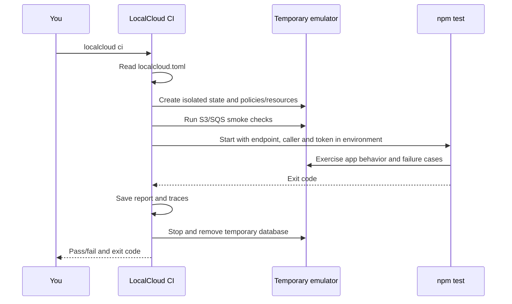

# Your Node.js app + LocalCloud: start-to-finish local CI

This guide runs on your computer. The project configuration is **`localcloud.toml` in your application's root**, beside `package.json`. The command is **`localcloud ci`**, run from that directory. No hosting account, remote pipeline or YAML is required.

The same approach works for other languages: replace the test command with that language's command.

## 1. Understand the three pieces

| Piece                       | Your responsibility                                      | Example                                                                     |
| --------------------------- | -------------------------------------------------------- | --------------------------------------------------------------------------- |
| Application                 | Code that performs useful work.                          | Store a document, enqueue work, process the document.                       |
| Application tests           | Assertions defining correct and incorrect behavior.      | The stored result must be uppercase; an unauthorized writer must be denied. |
| LocalCloud CI configuration | The command to run, resource setup and test environment. | `localcloud.toml` says to run `npm test` with S3/SQS and seeded resources.  |

LocalCloud cannot infer correctness by reading your JavaScript. It supplies the emulated dependencies and runs your tests. A Node process that exits successfully proves only that the process finished; your assertions prove the behavior you care about.

If your program does not use any emulated cloud services, ordinary `npm test` may be all it needs. LocalCloud is useful when the app depends on the supported AWS services or you want to exercise the emulator's IAM, state and resilience tools.

## 2. Install the LocalCloud command once

From the LocalCloud source checkout:

```bash
python3 scripts/install-cli.py
export PATH="$HOME/.local/bin:$PATH"
localcloud --help
```

Keep the checkout in place; the launcher imports it. No pip is required. Anyone using your LocalCloud project needs its code plus Python 3.11+. For this example also install Node.js 22+ and npm through your normal development setup.

Verify:

```bash
python3 --version
node --version
npm --version
localcloud ci --help
```

## 3. Try the complete example before adapting your app

From the LocalCloud checkout, copy the example into a **new empty app directory**:

```bash
LOCALCLOUD_SOURCE="$PWD"
mkdir "$HOME/my-node-app"
cp -R "$LOCALCLOUD_SOURCE/examples/node-app/." "$HOME/my-node-app/"
cd "$HOME/my-node-app"
```

The example has no npm dependencies, so no package installation is needed. Run:

```bash
npm run test:unit
localcloud ci
```

`npm run test:unit` runs three tests without a backend. `localcloud ci` reads this app's configuration, starts its own temporary emulator, runs backend smoke checks and executes `npm test`. That command runs the three unit tests plus six application integration tests.

You do not need a running Kubernetes instance, a port-forward, a personal management token or a manually started LocalCloud for this local CI run. It creates a new database, endpoint and management token for each invocation.

Expected key report fields on success:

```json
{
  "passed": true,
  "command_exit_code": 0,
  "application_tests": "passed",
  "error": null
}
```

The full report also includes backend checks, config path and duration. Test output appears before the report in your terminal.

## 4. Where every file goes

```text
my-node-app/
├── package.json                  npm scripts and Node version requirement
├── localcloud.toml               LocalCloud's project CI configuration
├── src/
│   ├── app.mjs                   document producer/worker business logic
│   ├── localcloud.mjs            small adapter for the supported emulator APIs
│   └── process.mjs               executable Node process
├── test/
│   ├── unit.test.mjs             no backend needed
│   └── integration.test.mjs      application + LocalCloud assertions
├── ci/
│   └── policies/
│       ├── app.json              permissions for the app test identity
│       └── reader.json           read-only identity used in negative tests
├── Dockerfile                    optional Node workload image for Kubernetes
└── artifacts/
    └── localcloud/               generated reports/traces; do not commit
```

All files above are supplied under [examples/node-app](../examples/node-app). `src/localcloud.mjs` is an example adapter, not an official AWS SDK. You can reuse it without writing curl commands. Existing SDK applications need their own compatibility checks against the supported API subset.

## 5. The configuration file, explained

The example's complete file:

```toml
version = 1

[ci]
command = ["npm", "test"]
services = ["s3", "sqs"]
iam = "enforce"
principal = "app"
timeout = 120
artifacts = "artifacts/localcloud"
export_state = false

[ci.seed]
buckets = ["app-documents"]
queues = ["app-jobs"]

[ci.policy_files]
app = "ci/policies/app.json"
reader = "ci/policies/reader.json"

[ci.env]
DOCUMENTS_BUCKET = "app-documents"
JOBS_QUEUE = "app-jobs"
```

| Setting                       | Meaning                                                                                                                                                                                             |
| ----------------------------- | --------------------------------------------------------------------------------------------------------------------------------------------------------------------------------------------------- |
| `version`                     | Configuration schema version; currently 1.                                                                                                                                                          |
| `command`                     | The actual application test command as an argv array. `['npm', 'test']` is two arguments; `'npm test'` is not a single executable.                                                                  |
| `services`                    | Declares supported service dependencies. Currently only `s3` and `sqs` are accepted. This declaration does not disable the emulator's other supported provider or change the built-in smoke checks. |
| `iam`                         | `off`, `soft` or `enforce`. The example uses enforce so denied-permission tests are meaningful.                                                                                                     |
| `principal`                   | Local caller identity supplied to your app as `LOCALCLOUD_PRINCIPAL`.                                                                                                                               |
| `timeout`                     | Maximum duration for the application test command, in seconds.                                                                                                                                      |
| `artifacts`                   | Where the run writes its report and request traces.                                                                                                                                                 |
| `export_state`                | Whether to also write resource contents to `state.json`. Default false.                                                                                                                             |
| `seed.buckets`, `seed.queues` | Resource names to create before tests. Existing fixture queues retain their attributes.                                                                                                             |
| `policy_files`                | JSON policy file per local principal, loaded before tests.                                                                                                                                          |
| `env`                         | Additional application environment variables; values must be strings.                                                                                                                               |

Configuration paths are relative to the directory containing `localcloud.toml`. The test command also runs from that directory, even when using `--config` from elsewhere. Config is discovered only in the current directory, not by searching parent directories.

`ci.env` cannot replace `LOCALCLOUD_` or `AWS_` variables; the runner supplies those so tests cannot accidentally target a different cloud. Use `ci.principal` to choose the local caller. The internal `ci-smoke` principal is reserved.

Secrets should come from your shell environment. Do not commit management tokens, database exports containing private data or credential files into the configuration.

## 6. What happens when you type localcloud ci



Your long-running Kubernetes instance and its data are unaffected. The runner's database is deliberately temporary. Only the configured artifacts survive unless your own tests write additional files.

With no config and no explicit application command, `localcloud ci` runs backend smoke checks only; its report says `application_tests: 'not_configured'`. A smoke-only pass is not a pass for your application. The project file removes the need to repeat the application command every time.

## 7. How the Node process connects

The runner starts the application with:

| Variable                         | What your app should do                                                                    |
| -------------------------------- | ------------------------------------------------------------------------------------------ |
| `LOCALCLOUD_URL`                 | Use this backend origin rather than hardcoding port 4566.                                  |
| `AWS_ENDPOINT_URL`               | Same origin for compatible clients that honor it.                                          |
| `LOCALCLOUD_PRINCIPAL`           | Local IAM testing identity, `app` in this example.                                         |
| `LOCALCLOUD_MANAGEMENT_TOKEN`    | Token for developer-tool APIs; the adapter attaches it automatically only to those routes. |
| `LOCALCLOUD_CI`                  | `1` during an isolated run; the destructive example tests require it.                      |
| `AWS_DEFAULT_REGION`             | Fixed `us-east-1`.                                                                         |
| AWS access-key variables         | Dummy testing values; they do not authenticate to real AWS here.                           |
| `DOCUMENTS_BUCKET`, `JOBS_QUEUE` | App-specific settings from `[ci.env]`.                                                     |

The example creates the client like this:

```js
const cloud = new LocalCloud();
const app = await new DocumentProcess(cloud).initialize();
await app.submit("document-1", "hello");
await app.processOne();
```

The producer writes `documents/document-1.txt` to S3 and sends a JSON job to SQS. The worker receives that job, reads S3, transforms the text, writes `results/document-1.txt`, then acknowledges the SQS message. If writing the result fails, it does not acknowledge the message. The unit test verifies that ordering.

The sample is intentionally small: it has no transactional outbox or producer retry loop. If S3 upload succeeds but SQS send fails, an input object can remain without a queued job. The example is a place to add and test the recovery behavior your application actually needs.

## 8. What to test for each supported service/tool

### S3: storage correctness

The supplied integration test checks the input object exists with the submitted bytes and the processed result contains the expected uppercase text. It verifies app behavior, not merely that an upload API returns 200.

For your own app, test missing objects, binary contents, allowed key paths and failures. For standalone manual operations, use:

```bash
localcloud s3 mb s3://assets
localcloud s3 cp hello.txt s3://assets/hello.txt
localcloud s3 ls s3://assets
localcloud s3 cp s3://assets/hello.txt downloaded.txt
localcloud s3 rm s3://assets/hello.txt
localcloud s3 rb s3://assets
```

These manual commands use your currently configured endpoint, not the CI instance after it has exited. The temporary run's state is visible through artifacts or inside the running test process.

### SQS: processing and acknowledgement

The example asserts a job is sent, processed once, acknowledged after storage success, and absent on the next receive. Backend smoke checks additionally verify invisibility of an in-flight message. The unit test asserts a failed result upload does not acknowledge work.

For your app, test retries and redelivery explicitly. Manual commands:

```bash
localcloud sqs create-queue --queue-name jobs
localcloud sqs send-message --queue-name jobs --message-body hello
localcloud sqs receive-message --queue-name jobs
localcloud sqs delete-message --queue-name jobs --receipt-handle 'CURRENT_RECEIPT'
```

See [the command reference](CLI.md) for visibility changes, attributes, purge and all other supported operations.

### IAM: both allowed and denied behavior

`ci/policies/app.json` scopes the application to its document bucket and work queue. `reader.json` allows object reads but not uploads or queue sends. The test verifies reads succeed and unauthorized mutations fail with 403.

The Node adapter attaches `X-Local-Principal`; dummy AWS credentials alone do not select local principals. IAM here is a limited policy-testing implementation, not real AWS identity authentication.

Manual policy tools:

```bash
localcloud iam put-policy --user-name app --policy-document file://ci/policies/app.json
localcloud iam generate-policy --user-name app --source successful
localcloud iam generate-policy --user-name reader --source violations
```

Generated proposals are for review and are never automatically applied.

### Snapshots: reproduce a known state

The test saves a named snapshot, creates an extra object, restores the snapshot and verifies the extra object is gone. This demonstrates a repeatable fixture/rollback pattern.

```bash
localcloud snapshots save before-test
localcloud snapshots list
localcloud snapshots restore before-test
```

Restore replaces the backend's complete resource state and policies. The supplied integration suite requires `LOCALCLOUD_CI=1` and must run through the isolated runner. Do not point these tests at your shared development instance.

### Export/import and fixture loading

The test exports a bundle, changes data, imports the original bundle and checks restoration. To preload your own saved fixture, add to `[ci]`:

```toml
fixture = "ci/baseline.json"
```

Create that bundle from the intended development instance:

```bash
localcloud state export ci/baseline.json
```

Resource state is validated before import. CI policies are loaded after the fixture, and missing seed resources are created afterward. Existing fixture queue attributes and contents are preserved. Traces, fault rules and named snapshot history are not included in state bundles.

### Persistence: distinguish local development from isolated CI

A normal instance retains its database across restarts:

```bash
localcloud start --port 4568 --data .localcloud/manual.sqlite3 --iam soft
```

Stop and restart using the same path to recover its resources. Kubernetes instances use their configured PVC. CI deliberately deletes its temporary database at the end; use fixtures and artifacts for repeatable CI state, not a shared persistent test database.

### Chaos: check failure behavior and recovery

The integration test injects S3 PutObject errors, checks the app surfaces a 503, verifies management remains accessible, removes the rule in a `finally` block and checks recovery.

Manual equivalents:

```bash
localcloud faults add --name outage --service s3 --operation PutObject \
  --probability 1 --latency-ms 25 --error-code ServiceUnavailable --status-code 503
localcloud faults list
localcloud faults remove outage
```

Use a finally/after cleanup whenever a test adds faults. The application must define its own retry or degraded-mode requirements. Latency-only rules can test timeouts; deterministic tests should use probability 1 and generous timing bounds rather than rely on random failures or exact millisecond measurements.

### Request Inspector and policy stream: see what actually happened

The example checks that traces contain the app's PutObject action and IAM decision without retaining its payload, and that generated policy proposals contain observed actions/resource pairs. It also verifies a denied queue action appears in the reader's violation proposal.

```bash
localcloud traces list
localcloud traces list --user-name app
localcloud iam generate-policy --user-name app --source successful
```

For a completed CI run, inspect `artifacts/localcloud/traces.json`; the temporary endpoint is no longer running. The dashboard and CLI Inspector commands view a currently running instance instead.

## 9. Run the process manually while developing

From the copied example directory, start a separate backend in Terminal 1:

```bash
localcloud start --port 4568 --data .localcloud/manual.sqlite3 --iam soft
```

In Terminal 2, from the same app directory:

```bash
export LOCALCLOUD_URL=http://127.0.0.1:4568
localcloud s3 mb s3://app-documents
localcloud sqs create-queue --queue-name app-jobs

npm start -- submit manual-1 'hello from my Node process'
npm start -- work
localcloud s3 cp s3://app-documents/results/manual-1.txt result.txt
cat result.txt
```

Expected result: `HELLO FROM MY NODE PROCESS`. The `submit` process exits after creating work; `work` processes at most one job and exits. Both use the bucket/queue names defaulted by the example. CI reads the same application code and supplies its own endpoint and resource settings.

Unset the manual endpoint when returning to your previous CLI connection:

```bash
unset LOCALCLOUD_URL
```

The CI runner always supplies its own endpoint to tests regardless of this shell setting. Manual CLI operations honor the environment override.

## 10. Add LocalCloud CI to an app you already have

From **your app directory**:

```bash
localcloud ci init --command npm test
```

This creates `./localcloud.toml` and refuses to overwrite an existing file. It does not create remote workflow files, install npm packages or modify your app code.

Then:

1. Ensure `package.json` has a real test script. For Node's built-in test runner, that can be `node --test test/app.test.mjs`.
2. Make your app/client read the supplied backend endpoint. Use the sample adapter or validate your own SDK's supported operations.
3. Write assertions for business behavior and cloud failures. Starting a server and waiting forever is not a test command.
4. Add resource seeds, environment settings and policy files as needed, using the example configuration above.
5. Run `localcloud ci` from that app directory.
6. Read test output and artifacts, fix failures, and run again.

For a long-running HTTP app, your test harness should start it, exercise its endpoints, then close it in teardown. The runner manages LocalCloud's lifecycle; it does not discover your framework or stop arbitrary servers started outside the test command.

With npm dependencies, run your project's normal `npm install`/`npm ci` first. LocalCloud does not install application dependencies automatically.

You can use any test tool:

```toml
[ci]
command = ["npm", "test"]
```

Other examples are `command = ['npx', '--no-install', 'vitest', 'run']`, `['python3', '-m', 'unittest', 'discover']`, or `['go', 'test', './...']`, provided those tools are installed in your project. Commands are passed directly, not through a shell. Shell operators such as `&&` are ordinary arguments; put multi-step logic in an npm script or an explicit script file.

## 11. Optional: run this Node process in Kubernetes

Local CI runs S3/SQS in a Python process and has **no Kubernetes executor**. Kubernetes workload tests require an actual configured cluster and LocalCloud instance; they are separate from this example's default `localcloud ci` run.

After following [Kubernetes setup](KUBERNETES.md), build the supplied Node image from the example directory:

```bash
docker build -t node-app:dev .
kind load docker-image node-app:dev --name localcloud
```

The LocalCloud image is a Python image; use this Node image for Node workloads. Add it to the existing instance's exact image allowlist:

```bash
kubectl -n localcloud patch localcloudinstance dev --type merge \
  -p '{"spec":{"workloadImages":["localcloud:dev","node-app:dev"]}}'
```

Keep the instance's port-forward running and select that endpoint in your CLI. If you used the manual port-4568 example above, unset its endpoint override first:

```bash
unset LOCALCLOUD_URL
localcloud configure --endpoint-url http://127.0.0.1:4566
localcloud auth login --kubernetes-secret localcloud-access --namespace localcloud
localcloud resources
```

Wait until `workloadImages` in the resources response includes `node-app:dev`; the operator may need a reconciliation/rollout cycle. This is the Kubernetes instance's own state, so create its resources if they do not already exist:

```bash
localcloud s3 mb s3://app-documents
localcloud sqs create-queue --queue-name app-jobs
```

For enforced IAM mode, provision resources using an allowed setup identity, and grant the default workload principal `test` the example app policy:

```bash
localcloud iam put-policy --user-name test --policy-document file://ci/policies/app.json
```

The normal example instance uses soft mode. Workload pods receive dummy AWS credentials and the endpoint, and the Node adapter defaults to principal `test` unless configured in its code; a saved host CLI profile is not inherited by a pod.

Submit a producer Job:

```bash
localcloud jobs run --image node-app:dev \
  --env DOCUMENTS_BUCKET=app-documents --env JOBS_QUEUE=app-jobs \
  --command node src/process.mjs submit kube-1 'hello from a Node pod'
localcloud jobs list
```

Wait for the returned producer Job to reach Complete before starting the worker:

```bash
localcloud jobs status lc-run-REPLACE_WITH_PRODUCER_NAME
localcloud jobs logs lc-run-REPLACE_WITH_PRODUCER_NAME

localcloud jobs run --image node-app:dev \
  --env DOCUMENTS_BUCKET=app-documents --env JOBS_QUEUE=app-jobs \
  --command node src/process.mjs work
```

Inspect the worker's status/logs and retrieve `s3://app-documents/results/kube-1.txt` with `localcloud s3 cp`. Jobs can be deleted with `localcloud jobs delete JOB_NAME` or allowed to expire after their cleanup TTL. Use a new document ID for repeated runs to avoid mixing old queue messages with new expectations.

For temporary cluster environments, use the `localcloud kube ... preview` commands documented in [Kubernetes usage](KUBERNETES.md). Those previews use private Services and operator-driven expiry; they do not turn the local runner into a cluster provisioner.

## 12. Read results and deliberately prove failures work

After a run:

```bash
cat artifacts/localcloud/report.json
```

`passed: true` means backend smoke checks and the configured application command succeeded. `application_tests: 'passed'` confirms an app command ran. `command_exit_code` is that process's exit code. `traces.json` shows actual service requests and evaluation decisions.

To prove the app tests matter, temporarily change the expected result in the first integration test to an incorrect value, run `localcloud ci`, then undo your edit. The Node assertion must fail, the report must show a failing application command, and LocalCloud must exit nonzero. A JavaScript test that catches and ignores every exception would hide bugs; assertions and nonzero exit codes are the contract.

Useful overrides:

```bash
# Use a project file from anywhere; commands/paths use that file's directory.
localcloud ci --config /path/to/my-node-app/localcloud.toml

# Change only the artifact destination or timeout for one run.
localcloud ci --artifacts artifacts/debug-run --timeout 180

# Override the configured command for a one-off diagnostic.
localcloud ci -- npm run test:unit

# Ignore the app configuration and run backend smoke checks only.
localcloud ci --no-config
```

For state artifacts set `export_state = true` or use `--export-state`. Those bundles contain resource contents and can include private test data; traces normally retain metadata only. Keep generated artifacts out of version control.

## 13. Troubleshooting

| Symptom                                  | Check                                                                                                        |
| ---------------------------------------- | ------------------------------------------------------------------------------------------------------------ |
| `localcloud` not found                   | Install the launcher and put `~/.local/bin` in PATH.                                                         |
| Only smoke checks run                    | Place `localcloud.toml` in the current app root, or use `--config`. Check `application_tests` in the report. |
| TOML parse error                         | Use TOML syntax, not YAML; start with `localcloud ci init --command npm test`.                               |
| `npm`/`node` not found                   | Install Node/npm in the same environment that runs the CLI.                                                  |
| Missing test script                      | Add `scripts.test` to `package.json`; CI does not generate business tests.                                   |
| Missing `LOCALCLOUD_URL`                 | Run through `localcloud ci`, or set the endpoint for manual development.                                     |
| `NoSuchBucket`/queue missing             | Align `[ci.seed]` names with `[ci.env]` and your app's configuration.                                        |
| 403 from your app                        | Check `ci.principal`, policy file actions and resource ARNs; inspect `traces.json`.                          |
| Reader denial test unexpectedly succeeds | Keep `iam = 'enforce'` for this example. Soft/off mode deliberately allows the operation.                    |
| Snapshot/import suite refuses to start   | It must use the isolated CI runner, not an arbitrary shared endpoint.                                        |
| Test command times out                   | Use a finite test command that closes its processes; increase timeout only when justified.                   |
| Job API says executor disabled           | Local CI is not a Kubernetes instance; use the separate cluster recipe.                                      |
| Socket permission error                  | Run in an environment permitting local loopback listeners.                                                   |

## 14. Scope and validation

The current AWS service providers are S3 and SQS subsets. IAM policy testing, snapshots, state transfer, chaos and inspection are developer tools around them. RDS, Cognito, Lambda, DynamoDB and other unimplemented services cannot be enabled by naming them in this config.

Python tests validate config discovery/schema, command/path overrides, resource/policy setup, fixture preservation and child environment. The Node example's three unit tests and six integration scenarios pass. In the restricted authoring environment, the six integration scenarios used a test-only stdin/stdout bridge into the real Python HTTP handler; normal example runs use actual fetch/HTTP through `localcloud ci`. A live TCP/npm CI run and the optional Docker/Kubernetes Node workload recipe were not executed here. Run the complete example on your development machine to verify those environment-dependent steps.
